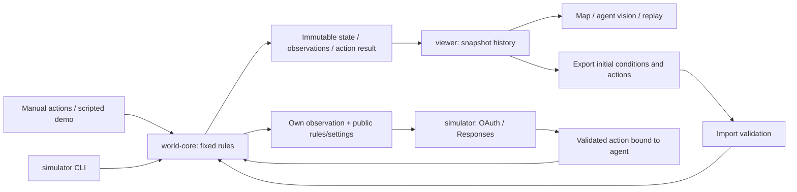

# System Architecture

This document owns current modules, interfaces, and dependency boundaries. Feature status belongs to [PRODUCT](docs/PRODUCT.md); context is in the [project overview](docs/PROJECT_OVERVIEW.md). The pure core exposes independently versioned protocols through one public package entry point. The fixed founding rules remain in world.ts; their grid and skill limits do not constrain the separate continuous protocol.

| Area                     | Scope                                                                                                          | Entry                                                              |
| ------------------------ | -------------------------------------------------------------------------------------------------------------- | ------------------------------------------------------------------ |
| Current Continuous World | Continuous-v1 / ex7–ex12: deterministic physics, reviewed mechanisms, persistent memory and recorded wellbeing | [Current protocol and game observatory](#current-continuous-world) |
| Legacy Foundation        | Fixed grid and three base skills; retained histories and separately versioned grid extensions                  | [Founding contracts](#legacy-foundation)                           |
| Development Workflow     | Repository-only experiment commands, scoped validation and PR checks                                           | [Workflow tooling](#development-workflow)                          |

The main viewer opens the current game observatory; `/classic.html` retains the grid inspector. Both replay saved experiments without model calls. A historical run keeps its original protocol even when shown in the newer presentation.

## Current Continuous World

### Continuous world and game observatory

The independent [continuous-v1 protocol](docs/CONTINUOUS_WORLD.md) adds pure continuous-types/data/policy/geometry/observation/registry/base/kernel/tasks/wellbeing modules behind world-core's public entry point. WorldState and founding world.ts retain their historical semantics. Floating-point state, same-start transactions, swept collision, private navigation, persistent processes and event-grounded wellbeing share a deterministic time step. Reviewed code packages register typed interfaces and optional state schemas, migrations and personal observation adapters; individual mastery remains separate.

Inferred write detection compares unchanged entity structure directly, with the
original canonical-signature comparison as fallback. It has no mutable cache,
numeric tolerance or omitted fields. Replay signatures, conflict keys and
protected-account checks retain their original semantics; this avoids repeated
serialization across eighteen simultaneous proposals without changing rules.

Simulator continuous-scenario/input/provider/run modules own the independent initial world, minimal ordinary goal, dynamic JSON interface schema, exact-attempt journals and persistent conditional tasks. Repository continuous-cli/files/source/store/analysis/preflight modules provide the experiment commands, retain versioned source and segmented deterministic evidence, and pause globally on budget exhaustion. Source review may inspect pure viewer visual registrations; core never imports the viewer or Node services.

The separate observatory entry renders continuous-scene/visuals/history modules with a bounded segment cache, camera, event and state inspection. Its historical adapter preserves old grid positions and explicitly labels the different simulation. Camera time and animations never affect world time. See [ADR-0018](docs/decisions/0018-continuous-world-and-wellbeing.md).

### Forest extension

The opt-in [forest-v1 extension](docs/FOREST_WORLD.md) retains the continuous replay envelope and historical transitions. Pure forest-foundation/environment/lives modules own resource properties, deterministic climate/animals, finite-life settlement and event declarations. Continuous geometry owns shared enclosure walls, doorway passage, occlusion and indoor predicates. Optional package death cleanup releases pending escrow before respawn; protected life accounts cannot be changed by ordinary handlers.

Simulator forest-scenario owns genesis while existing continuous input/provider/run modules select forest privacy, event schemas, mandatory experience/visual reviews and normal post-death decisions. The original forest feasibility oracle was isolated from formal inputs. The existing durable store binds the round-200 technical checkpoint and retains the same source, call, development path.

Request-driven forest-wildlife, food-assessment and shelter packages add paid attention, conserved fractional escrow, persistent enclosures and measured cold relief through the same registry. Food and construction completion settle after injury/death before reward evaluation. Simulator forest-context projects bounded decision evidence without changing complete stored personal records or earlier calls. The thermal split preserves unsheltered results and shared geometry determines actual shelter occupancy.

Active warming settles measured exertion after ordinary physiology and shares the existing relief source through validated alternative event triggers. Versioned forest-routing uses observed geometry and exact swept collision to supplement the broad navigation grid with bounded local corner connections. Navigation and paid route inspection share target resolution; diagnostics distinguish proven obstruction from unknown search or terrain, and never move an actor. Geometry revisions invalidate stale route evidence without changing physical instances or historical transitions.

Viewer forest-canvas draws read-only scene frames and registered components; observatory retains camera, selection and replay. The explicitly isolated forest-lab accepts authored test recordings for visual inspection. Neither renderer imports simulator code or advances the world. See [ADR-0019](docs/decisions/0019-forest-lives-and-experience.md).

### Forest experience policy

The opt-in [experience policy](docs/FOREST_EXPERIENCE.md) keeps old transitions while adding kernel-level reference resolution and completion/progress contracts. Pure forest-references resolves only observed identities (or dated navigation memory). Forest-experience settles substantial actual meals and slow mental state; continuous wellbeing owns event-grounded transient/maintained sources. Simulator forest-experience-scenario fixes initial conditions and existing public capabilities without individual mastery; forest-experience-context computes bounded factual summaries. Existing checkpoints, source revisions and scoped validation retain the same development and delivery path. See [ADR-0021](docs/decisions/0021-forest-execution-and-experience.md).

The round-447 requested portable-insulation package adds an optional persistent stack component. Its work module owns costed escrow, manufacturing, repairs and lifecycle cleanup; a separate pure exposure helper composes physical cooling reduction inside forest physiology without a dependency cycle. Shared transfers preserve indivisible item identity. The canvas reads actual equipment, wetness and condition, while inventory and ground labels retain the item ID. This package is activated only at its recorded development boundary, not in prior archives or initial personal mastery.

The later request-driven fire, willow-material and rain-canopy modules share that physical path. Fire separates paid fuel/kit work, environmental combustion and exposure; willow retains finite stock, actual material lineage and unchanged compatible recipe costs. Canopy construction owns explicit material escrow and real post geometry, while a separate environment phase settles roof wear and mantle moisture once before insulation. Its roof is not an enclosure or a heat source. All experience evidence reaches the central wellbeing evaluator, which settles each shared source once across alternative triggers.

The round-495 operation-continuity package stores paid bindings in actor state independently of replaceable plans. The shared dispatcher accepts the original or canonical identity, including consistent typed references in declared material arrays; it does not re-resolve consumed inputs or reinterpret unrelated fields. Life/tick identity, finite progress and cancellation remain authoritative. Valid pending legacy work can migrate; completed/cancelled work cannot be recreated.

The simulator's lossless input codec applies only to large experience observations/reviews. Exact shared values and named-column record tables reconstruct the entire JSON input; byte protection measures the same representation sent to transport. Optional output placeholders normalize only declared optional fields before public validation. Raw inputs, model outputs, failed attempts, technical pauses and source activation boundaries remain retained. Formatting repairs are not evidence that model interpretation is unchanged.

The optional `local-fire@1` package uses the shared resolver for nested material references, persistent kit identity, paid work and physical hearth geometry. Its finite weather-dependent combustion runs before physiology; heat enters before thermal damage, while event-grounded maintained refuge settles in the central wellbeing account. A separate read-only visual projects actual work, fuel, flame, cover and residue. See [the reviewed extension contract](docs/FOREST_EXPERIENCE.md#reviewed-local-fire-extension).

`willow-materials@1` extends existing finite stock with paid material separation, provenance and physically checked recipe compatibility. Optional strict-output fields use explicit null transport placeholders, normalized only when the public schema declares omission legal; shared reference validation then applies normally. Context encoding and output normalization do not alter world state, goals or byte/call budgets.

The reviewed `recuperate@1` extension settles paid recovery only after real exposure, injury and death. Its terminal result updates the existing task outcome and operation cursor; it does not modify ordinary rest, grant health on installation or create collision geometry. See the [experience protocol](docs/FOREST_EXPERIENCE.md#requested-recuperation-at-round-777).

## Legacy Foundation

The diagram and module table below describe the original fixed-grid path. Later grid protocols have their own sections; continuous-v1 uses the separate kernel described above. Restrictions such as three fixed skills and no host-code skill execution apply to the foundation.

### Foundation modules and data flow



Runtime dependencies are `simulator → world-core` and `viewer → world-core`. The applications do not depend on each other. Playback reads existing snapshots without running transitions; only new actions and import reconstruction execute actions.

| Module            | Location                                                                                                | Responsibilities and interfaces                                                                                                                                                  | Allowed dependencies                                  | Excluded responsibilities                                                 |
| ----------------- | ------------------------------------------------------------------------------------------------------- | -------------------------------------------------------------------------------------------------------------------------------------------------------------------------------- | ----------------------------------------------------- | ------------------------------------------------------------------------- |
| world-core        | [world.ts](packages/world-core/src/world.ts); [index.ts](packages/world-core/src/index.ts) only exports | Base rules, settings, entities, three skills, validation, immutable transitions, automatic vision; `createWorld`, `stepWorld`, `stepWorldRound`, `parseWorldAction`, `isVisible` | Its own source and ECMAScript                         | UI, Node I/O, network, clocks, randomness, AI, arbitrary host-code skills |
| simulator         | [apps/simulator/src](apps/simulator/src/)                                                               | Seeded random runners return bounded histories; protocol runners own observations, OAuth/Responses transport and durable execution                                               | Own source, public core API, Node built-ins and fetch | Rules, visualization, continuous NPC control                              |
| viewer            | [apps/viewer/src](apps/viewer/src/)                                                                     | Map and controls; `timeline.ts` manages snapshots and replay files; `scenario.ts` defines the demo                                                                               | Own source, public core API, browser APIs             | Defining skills, model decisions, server persistence, editing past frames |
| repository checks | [scripts](scripts/)                                                                                     | Experiment commands, archive validation, scoped checks, browser evidence, documentation and PR checks                                                                            | Node, development tools, CLI source for validation    | World rules, automatic aesthetic judgment, proof of honest review         |

Cross-package imports must use `@self-evolving-world/world-core`, never internal source paths. Vite and Playwright are development tools. The browser application has no frontend framework or external service dependency.

## Bounded external decisions

The simulator owns [OAuth](apps/simulator/src/chatgpt-auth.ts) and the [Responses transport](apps/simulator/src/responses.ts). Network calls, credential files, cryptographic randomness, expiry clocks, and output filenames stay at this application boundary. Existing dependency rules already permit Node built-ins and the public core API here, and prohibit both applications from importing each other's production source.

OAuth uses the documented loopback/PKCE flow, verified identity and explicit plan permission. The credential file stays in the user's application configuration directory, outside the repository and viewer. The transport uses only the public Responses API, requests streaming with storage disabled, requires a completed response, and permits no model tools or continuation. Complete JSON responses undergo the same checks if returned despite streaming being requested. Missing Content-Type is handled by recognizing SSE or JSON from the bounded body, without relaxing completion or action checks. The output records the received format. The CLI saves bounded response evidence with bearer redaction for offline diagnosis, including failures. Captured metadata and recorded transport errors are also redacted, and credential-bearing decisions are rejected; response capture does not issue new requests. [ADR-0007](docs/decisions/0007-single-round-model-adapter.md) explains these choices and limitations.

## Survival programs

The optional [survival extension](docs/SURVIVAL_EXPERIMENT.md) uses core survival.ts for immutable vital transitions and program.ts for finite behavior parsing, scheduling and deterministic reconstruction. Base skills remain in world.ts; its internal round resolver can retain idle/dead occupancy without generating synthetic base actions. Public APIs expose createSurvivalWorld, stepSurvivalRound and bounded program-run operations. No core module imports Node, networking, clocks or external AI.

The simulator's [program parser](apps/simulator/src/program-provider.ts) and [survival replay](apps/simulator/src/survival-run.ts) reconstruct ex3 from its recorded inputs and outputs (new survival runs are retired). Each actor received its own observation/vitals, previous program/outcome and public rules; only complete provider output was parsed into actor-bound code. Programs executed to completion before replanning, with five attempted calls per actor and 60 rounds maximum. Failed/invalid attempts counted and led to explicit wait fallback; learning was always denied. These are finite commands, never host-language execution or skill generation.

The retired survival run command persisted each attempt before inference and saved a fresh version-3 archive. [Analysis](scripts/survival-analysis.ts) reconstructs eligibility and all transitions, compares private input and completed response to each saved program, independently checks mild vitals and shared world invariants, and generates report/chart artifacts. Root development tooling declares a workspace dependency on the public core API; application dependency boundaries are unchanged. CI and viewers never call the provider. Interrupted inference cannot be resumed; complete simulation data can resume browser capture only.

Replay version 3 contains programs, null-code failure records, survival configuration and the horizon. The viewer reconstructs through the pure scheduler and displays code, progress, vitals and learning denials. Request/response evidence remains in model-calls.json, outside browser assets and without credentials or reasoning traces. See [ADR-0012](docs/decisions/0012-survival-programs.md).

## Survival-driven skill extension

The separate [learning protocol](docs/SKILL_LEARNING_EXPERIMENT.md) adds pure learning.ts, learning-program.ts, learning-environment.ts and a constrained skill compiler/interpreter. world.ts retains all base rules and exposes only its internal snapshot/round helpers to extensions. The public index exposes learning types and deterministic transitions. Version-4 replay stores initial environment, ordinary programs and reviewed action batches; reconstruction performs no model calls.

Simulator learning-input/provider/run/scenario modules own the private ordinary inputs, World Agent review templates and development-barrier acceptance used to reconstruct ex4; new learning runs are retired. Generated skill code has no host evaluation: fixed core primitives enforce resource conditions/costs, effects and unchanged starvation rules. Registry identity is separate from actor proficiency. Repository learning analysis tooling audits the complete evidence and measured artifacts. No application imports another application's production code. See [ADR-0015](docs/decisions/0015-survival-driven-skills.md).

## Heterogeneous demand-driven evolution

The [evolution-v1 protocol](docs/EVOLUTION_EXPERIMENT.md) adds pure evolution-types/schema/environment/execution/program modules behind the same public core API. Resource types and ecological distributions are data-driven additions; executable JSON operation compositions use a generic physical envelope. Finite site assignments persist including zero. Transactions enforce costs and ownership, while individual learning and discovered type properties remain separate from shared registries. Base world.ts adds only an optional versioned state field; legacy protocols remain unchanged.

Simulator evolution-scenario/input/provider/run modules own the 48 by 48 geography, four comparable private inputs, the independent-role world prompt and the request templates used to audit ex5. Repository evolution analysis/smoke modules validate the retained archive; new evolution runs are retired. The viewer reconstructs version5 programs/proposals and renders ecology with fit/detail map scales. No new runtime dependency direction, external service or review agent is added. See [ADR-0016](docs/decisions/0016-demand-driven-ecology.md).

## Numbered experiments

The retained version-1 simulator [random-run.ts](apps/simulator/src/random-run.ts) reuses its founding scenario and calls only the public core API. A nonzero explicit xorshift32 seed drives action categories and targets; each scheduled agent uses its current observation. Lin/Moss/Sol act sequentially for 3-500 total actions. No model provider, credentials, networking or clock participates in this policy. Its base semantics and version-1 replay remain unchanged. New runs use [synchronous-run.ts](apps/simulator/src/synchronous-run.ts): all actors choose from round-start observations, same-cell collection takes priority, and visible attraction mixes with random exploration. The core [round extension](docs/SYNCHRONOUS_ROUNDS.md) adds atomic batch resolution and replay version 2 without changing version-1 history.

Repository [experiment tooling](scripts/experiments.ts) owns exclusive `exN` allocation, manifests, JSON artifacts and consistency checks. [Analysis](scripts/experiment-analysis.ts) independently checks every snapshot and derives counts, reports and vector charts. [CLI orchestration](scripts/experiment-cli.ts) runs seeded random experiments, captures Chromium screenshots and writes companion analyses. These development tools may inspect application APIs; applications do not import scripts or each other.

[Synchronous analysis](scripts/synchronous-analysis.ts) additionally verifies per-actor simultaneous destinations/collisions, exact inventory transfers, all-agent events and successful collection. Manifest versions select the matching generator and report format; total actions and rounds are explicit.

The retained [experiment archive](experiment/README.md) includes goals, configuration, outcomes, replay and real viewer/chart images. The validator reconstructs seeded behavior or saved version-3/4/5 programs and reviewed batches and compares all computed data, checks invariants and artifact hashes, and requires completed browser evidence. Selected browser tests independently import affected recorded replays, verify initial/intermediate/final state and export invariance, decode archived images, and capture fresh screenshots. Historical files are not rewritten by validation. All retained experiment content participates in task fingerprints.

The viewer's [Vite configuration](apps/viewer/vite.config.ts) calls repository [asset publication tooling](scripts/experiment-assets.ts) at startup/build time. Only integrity-checked, completed records produce a versioned catalogue and exact replay/chart assets under `experiments/`. Running or failed captures are omitted from the catalogue, but still block full task validation. The development server serves these assets from memory; production emits static files alongside the viewer. Restart/rebuild refreshes the catalogue. No generated assets are written into tracked source or the historical archive.

Browser [experiment navigation](apps/viewer/src/experiments.ts) reads these same-origin static files through browser APIs, validates catalogue/replay data and commits a selection only after successful reconstruction. Sequence tokens prevent stale loads from replacing later selections or local sessions. Continuous segments load in an archive-owned browser worker through a three-entry LRU cache of in-flight promises. Fetching, parsing and deterministic verification stay off the UI thread; only the requested verified world and task state cross back. New seeks cancel obsolete work at verified round boundaries, and archive changes terminate the worker. Playback waits for each seek to settle instead of queuing interval requests. A segment-local reader serializes seeks and reconstructs only the requested prefix, retaining verified frames and task cursors; repeated or backward seeks do not simulate again. Every advanced round retains state/event/cursor verification, and a failed reader cannot resume partial state. Forest presentation uses accessible SVG hit bounds, a simplified terrain-run minimap and a camera/perspective/frame-bound Canvas terrain surface; full hidden terrain SVG and per-frame bitmap resizing are avoided. See [ADR-0024](docs/decisions/0024-responsive-replay.md). The whole segment still passes its indexed byte hash before display; offline archive acceptance remains a full reconstruction. The `experiment` query parameter supports direct links, refresh and back/forward. Saved histories disable actions even at the latest frame; playback, inspection, vision and export use the existing timeline. Production viewer source retains its own-source/public-core-only dependency boundary. See [ADR-0009](docs/decisions/0009-static-experiment-browser.md).

The [change classifier](scripts/harness.ts) considers committed branch changes against `origin/main`, working changes, deletions and untracked files, and enforces archive preservation. The [impact planner](scripts/validation-plan.ts) maps actual paths to selected protocol, browser and documentation checks; code changes retain all unit tests. Metadata reads and asset builds do not reconstruct worlds. Deep validation caches fingerprint-bound results locally so unchanged inputs are reused.

[`pnpm pr`](scripts/publish-pr.ts) pushes a focused branch, creates or updates its PR, waits for the required checks and merges. It is Node development tooling and never generates review verdicts.

## One fixed core file

The [World Foundation](docs/WORLD_FOUNDATION.md) owns the fixed version-1 specification, including the viewer's starting item catalogue. Future evolution must use separate extension definitions while preserving that specification and the base skill semantics. This document owns the implementation contracts below.

`world.ts` contains all base settings, types, and skill implementations. The foundation has no plugin registry; learning-v1 owns a separate constrained registry. `CORE_RULES` and its skill array are frozen, with version `1` and exactly `move`, `pickup`, and `try`.

`createWorld(setup)` accepts optional initial settings and entities, copies inputs, validates them, and freezes the result. Defaults are `width=16`, `height=12`, and `visionRadius=4`. Coordinates are integers with origin `(0, 0)` at the top left; `0 ≤ x < width` and `0 ≤ y < height`. Each dimension supports 1–64 cells, vision radius 0–64, at most 32 agents, and at most 256 items. With no arguments it creates an empty world. Demo entities belong to the application layer.

Settings, rules, positions, entities, inventories, observations, and events are frozen at runtime. Every action returns a new snapshot; unchanged frozen data may safely be shared. **Rules and initial settings stay fixed while positions, item ownership, and tick change.** No action can resize the world, change vision or alter the base skill set. The learning extension registers compositions without changing those rules.

## Actions and error semantics

```typescript
type WorldAction =
  | {
      type: 'move';
      agentId: string;
      direction: 'north' | 'east' | 'south' | 'west';
    }
  | { type: 'pickup'; agentId: string; itemId: string }
  | { type: 'try'; agentId: string; skill: string };
```

- `move` travels one cardinal cell without wrapping, crossing boundaries, or entering another agent's cell. Items do not block movement.
- `pickup` collects a ground item from the same cell, removes it from the ground, and transfers it to the acting agent's inventory. An item has one owner.
- `try` returns `skill-unavailable` for unknown skills and records the request without execution, generation, or registration. Existing skills return `skill-already-exists` without implicit execution. Legacy aliases remain accepted for old replay compatibility; their source literals use Unicode escapes under the English content policy.
- A well-formed command from a known agent consumes one logical tick even when movement, pickup, or a skill request is rejected. The result is stored in a `WorldEvent`.
- Malformed commands, unknown agents, invalid ticks, or integer overflow throw `RangeError`; the caller retains the previous world. No path mutates input snapshots.

Public TypeScript types do not replace validation of external data. `parseWorldAction(unknown)` validates commands; imports must not bypass it with a type assertion.

## Automatic observations

Creation and every transition generate an `Observation` for each agent without a separate observation skill. Vision uses inclusive Euclidean distance with no facing direction, walls, or occlusion.

An observation includes the agent's own state and inventory, public details of visible agents, and visible ground items. Other agents' inventories are excluded. All observations update after movement and pickup. Global view is a human inspection tool; agent view renders only the selected observation. This is not client-side data secrecy or an authorization boundary.

## History, playback, and files

`Timeline` stores an initial snapshot and one snapshot after each single action (version 1) or whole round (versions 2–4), up to 500 actions/rounds or 501 frames. Version-2 timelines carry `schedule: simultaneous-v1`, display all event results together and remain read-only even after local import. `frameAt` only reads existing snapshots. The playback timer belongs to the viewer and neither advances core time nor repeats actions. Historical frames and active playback disable actions. Returning to the latest frame allows appending; branching and editing history are unsupported.

The `self-evolving-world/replay` format contains file and core versions, initial settings/entities, and an action sequence for version 1 or explicit action batches for version 2. Import is limited to 1 MB and validates versions, fields, counts, and world constraints before reconstructing all snapshots deterministically. The current session is replaced only after success. Host-executable code, mutable rule definitions and arbitrary snapshots are not accepted. Version 3 accepts only validated finite behavior statements and the fixed survival-v1 configuration, with a maximum of 60 rounds. Importing different initial settings opens another world rather than modifying the current world's rules.

Local session history lives in page memory and does not survive refreshes automatically; JSON export supports later replay. Experiment URLs reload retained archive data after refresh; they do not persist the selected frame or local edits. Interface text uses `textContent`; vector illustrations use only fixed local markup, so imported names are never executed as HTML. Project-authored copy and demo names are English; imported user data retains its original text and Unicode support.

## Executable constraints and builds

- [dependency-cruiser](dependency-cruiser.config.cjs) enforces core independence, public APIs, no viewer imports from Node/CLI, and no cycles or unresolved dependencies.
- [Strict TypeScript and ESLint](tsconfig.base.json) cover source, tests, and scripts. The independent core check excludes Node and DOM types; the independent viewer check uses browser types only.
- Root TypeScript, Vitest, and viewer type checks resolve core source, so a clean checkout needs no prebuilt `dist`. `pnpm build` builds the core before applications; Vite bundles the actual package export.
- `pnpm dev` builds the core before starting the viewer; rerun after core changes. `pnpm test:e2e` uses a dedicated preview process rather than an existing user server.
- `pnpm check` runs types, lint, formatting, dependencies, Vitest, builds, archive and analysis checks, Chromium interactions, and documentation. See the [development workflow](docs/DEVELOPMENT.md).
- `pnpm validate` derives and runs the affected automated checks. Browser [validators](apps/viewer/e2e/validators.ts) check runtime health and layout; [anomaly scenarios](apps/viewer/e2e/anomalies.spec.ts) check invalid movement, ownership, and vision.

The [PR contract](docs/PULL_REQUESTS.md) checks the PR description, plan reference and companion analyses for new experiments. The unit reporter rejects skipped or incomplete suites. These checks remain development tooling outside the core; GitHub protection is separately configured. None of them proves semantic correctness or that a screenshot was inspected.

## Development and coevolution boundary

The separate [coevolution-v1 protocol](docs/COEVOLUTION_EXPERIMENT.md) uses pure `coevolution-*` modules and a distinct optional WorldState extension. Version6 reuses foundation movement and schema utilities without changing older transitions. It adds material-backed object effects, finite niche allocations, delayed recipes, personal projects and total-attempt scheduling. Node-only request templates and repository-only audit adapters reconstruct ex6; new coevolution runs are retired. The existing viewer reads the new state and reconstructs version6 without models. [ADR-0017](docs/decisions/0017-development-coevolution.md) explains the version-specific modules and finite physical envelope.

Requested growth effects use optional versioned object definitions, with material/habitat prerequisites, maturity intervals, stock ceilings and lifetime output bounds. The repository-side source history retains full engine revisions and barrier prefix hashes from ex6's narrowly scoped interpreter development; validation verifies that retained history. Base configuration, metabolism, carrying/rest, scenario, prompts and scheduler remain frozen. Development source validation and ordinary declaration validation are distinct from final full-task acceptance; no Node I/O or model service enters the pure core.

## Development Workflow

The [development workflow](docs/DEVELOPMENT.md) is a short sequence of standalone commands; no coordinator or task journal exists. `scripts/continuous-cli.ts` allocates and advances continuous experiments, `scripts/continuous-repair.ts` converts eligible technical pauses into counted development handoffs, and `scripts/experiment-cli.ts` runs random experiments, captures screenshots and writes analyses. `scripts/experiment-review.ts` binds companion analyses in `experiment/analyses/exN/` to the original archive digests and every actor; numbered allocation ignores that directory. `scripts/validate.ts` runs the scoped checks, `scripts/check-pr.ts` and `scripts/pr-policy.ts` check PR descriptions, and `scripts/publish-pr.ts` publishes. See [ADR-0027](docs/decisions/0027-lean-development-workflow.md), which supersedes the task coordinator of ADR-0013 and ADR-0014.

## Future modules (Planned)

[PRODUCT](docs/PRODUCT.md) reserves future scope for an unattended production NPC service (F-102), richer cooperation/trade systems (F-103), general technology governance beyond reviewed experiments (F-104), unrestricted evolution with general rollback (F-105), and shared durable storage with general cross-protocol migration (F-106).

Bounded World Agent review, versioned skill/mechanism extensions, persistent tasks and individual memory already exist in the experimental protocols described above. Continuous packages can define explicit state migrations; this does not provide general migration between protocols. The founding `try` action still only records requests and never installs capabilities or rewrites its rules.

## Scoped acceptance dependencies

[ADR-0020](docs/decisions/0020-scoped-validation.md) separates task/diff identity from check dependencies. [Scope rules](scripts/validation-plan.ts), [input fingerprints](scripts/validation-inputs.ts), and [cached receipts](scripts/validation-cache.ts) remain repository tooling. Completed archive metadata, integrity and deep reconstruction are separate APIs. Batched preservation covers complete historical trees. Runtime source continuity excludes acceptance tooling without modifying retained snapshots. CI uses fresh evidence, stable required check names and one quality run per PR commit.

## Fresh development policy

The [open development policy](docs/OPEN_DEVELOPMENT.md) composes the existing
continuous kernel with immutable experiment scope. `continuousRegistry(world)`
filters historical packages; `v7Install` independently enforces scope and
personal learning remains a separate game transition. The fresh scenario installs
only the explicit foundation allowlist. Historical handlers remain available for
historical replay, with new behavior gated by `config.development`.

`forest-climate` owns shared pure climate/event helpers; `open-physical` owns local
forcing and material properties; `open-ecology` advances plants and animals.
`open-processes` manages paid escrow, conditions, work, heat, wear and conserved
outputs for reviewed capabilities. It supplies no mature recipes.
`open-foundation` provides paid probes, record lookup and two-party evidence
exchange. `open-projects` stores actor-authored intentions, while verified knowledge
and actual events remain separate. `open-experience` grounds bounded practice and
routine feedback. The simulator's `open-context` presents compact current records
and discoverable current-world capabilities; raw journals and replay retain full
history. The existing task barrier and source validation own development delivery.

The 2D viewer reuses existing object components and adds local soil overlays,
seedling/injury states, process progress and personal project/knowledge inspection.
[ADR-0022](docs/decisions/0022-fresh-open-development.md) records isolation and
context tradeoffs; [PRODUCT](docs/PRODUCT.md) owns acceptance status.

## Collective life extension

The optional [collective policy](docs/COLLECTIVE_LIFE.md) retains individual physical actors and the continuous round barrier. Per-group attention constructs either personal observations or actual shared reports; public proposals cannot write individual tasks. Local reporting and teaching are core transactions. `experiment:continuous -- new collective-a` and `new collective-b exA` allocate isolated A/B archives; B reuses A's preflighted physical baseline, and `extend` preserves B's short window before continuation. The policy is absent from historical worlds, whose semantics remain unchanged. See [ADR-0023](docs/decisions/0023-collective-life.md).

`collective-policy` and `collective-types` define optional group identity,
tendencies, commitments and persistent personal intent on each physical actor.
`collective-social` implements local reports, voluntary responses, two-part
teaching and event-grounded risk/trust updates. The wellbeing engine applies
its preference-dependent experience scale to actual qualifying events. The ordinary task cursor
continues to own paid execution; a public proposal cannot replace it.

`collective-input` constructs three separate packet shapes: A's observed group
union, B's one-member private packet, and B's report-only coordination packet.
`collective-controller` selects attention slots, tracks waiting and preserves phase
counters. Provider requests are fresh and bounded; the group endpoint is not a
shared secret-bearing conversation. The normal runner settles physical actions
before accepting public proposals at the same-round barrier. Retained request
builders validate historical packets against their source revision, including
same-round technical boundaries, without replaying model inference.

The generated collective packages remain scope-bound to their originating arm.
`collective-work` reuses conserved escrow and paid partial progress for actual
material operations. Optional `material-lots` retains original component identity,
physical properties, age and provenance through combination, splitting, transfers,
consumption and per-component spoilage. A combined stock is not automatically one
connected physical sheet. Fractional root work therefore assesses real surface
geometry separately and requires additional personal learning. Private inventory
inspection preserves complete bounded execution-time pages outside the compact
summary; its reader exposes no other member's possessions or hidden chemistry.
These runtime extensions enable requested actions, but installation alone creates
no stock, personal mastery or benefit.

The human viewer can inspect the full recorded world and select personal state,
intentions, known facts, work progress and dated inventory pages. That inspection
is explicitly separate from the model's packet. Existing geometry and process
renderers display real outputs; authored fixture scenes remain labeled as tests.

The scoped `collective-small-drying` package separates requirement assessment,
physical site/component checks and paid work from its public interface. It reuses
the existing per-lot moisture/age kernel with a conditional underside-exposure
multiplier; historical trays take the unchanged path. The completed sheet remains
non-solid, while its ballast is an actual solid assembly component. Passive
conditions do not require model scoring, and a missing support never becomes
a free-standing preservation bonus. Personal before/after inspection is separate
from passive physics and uses the existing deduplicated understanding source.

The B-only `collective-tray-placement` evaluator preserves the original root
worksite predicates for construction. `collective-tray-clearance` projects a paid
personal diagnostic through current observation and stores dated results; its
package adds separate learning and the canonical understanding trigger. The
viewer draws those recorded nonphysical outlines, never a fabricated facility.

The B-only `collective-tool-assessment` module reuses the unchanged pure
`collective-tool-predicate` used by fractional preparation. It provides paid
personal tool-only records, while generic contact representation runs on a copy
and cannot mutate material. The viewer separates provenance-backed hardness from
experimental evidence and renders only a brief inspection indicator.

## EX9 presentation preview

`apps/viewer/ashen.html` loads the isolated `src/presentation/ex9` Canvas view.
It shares the existing replay worker and pure continuous geometry queries, but
has no simulation, capability installation, inference or archive-write path.
An isolated continuous presentation clock consumes a bounded verified snapshot
buffer (one preceding and eight ahead); the worker remains the sole verifier.
No timestamp debt accumulates during buffering. Boundary objects and evidence
remain exact while guarded adjacent motion and continuous gait are interpolated.
A separate damped camera follows rendered positions; window-filling HUD and
fullscreen controls do not change other replay entries. The original observatory accepts optional round/actor URL
parameters for the return link. Ashen asset provenance, actual event bookmarks
and separate presentation evidence are described in the
[presentation guide](docs/presentation/ex9/README.md) and
[ADR 0025](docs/decisions/0025-ex9-presentation.md).

### Bounded long-development requests

The optional `long-development-v1` path reuses the continuous runner and registry.
`long-context.ts` selects personal facts, active work and current-scope capabilities;
read-only query batches remain inside the durable round barrier. `long-request.ts`
provides a constant output envelope; execution still validates complete plans and
interface arguments. `long-tokens.ts` keeps approximate request measurements and
conservative unknown-use reservations distinct from actual provider usage. The
single ledger is fungible across roles and stages. The core only receives immutable
configuration and actions; it has no tokenizer, model transport or archive I/O.

`long-pressure.ts` calculates a fixed recurring environmental schedule. Existing
climate, ecology and bounded experience settlement consume it only for the new
policy. No old skill package is enabled by retaining its source. The shared Ashen
presentation selects an archive through `presentation/session.ts`, while event
bookmarks are separate presentation metadata copied by the existing asset adapter.
See [ADR 0026](docs/decisions/0026-bounded-long-development.md) and the
[protocol](docs/LONG_DEVELOPMENT.md) for boundaries and limitations.

The opt-in culture scenarios add world-core `expression*.ts`: an authored, scope-bound
`foundation-expression@1` package whose `name`, `mark`, `tell` and `invite` handlers create
non-solid sign objects and spoken-word events, an environment hook that delivers heard
words, records attendance and expiry and, when enabled, derives interface-free evidence for
`derived` satisfaction rules, and the bounded private-memory parser. `continuousRegistry`
includes the package only when `longDevelopment.culture` enables it. The simulator's
`long-culture.ts` builds the six-person genesis; `long-context.ts` and `long-request.ts`
add the culture packet sections and prompt variant only in that scope, and `long-tokens.ts`
reports the frozen early token ceiling enforced by the runner. See
[ADR-0028](docs/decisions/0028-culture-scenario.md) and the [design](docs/CULTURE_SCENARIO.md).
