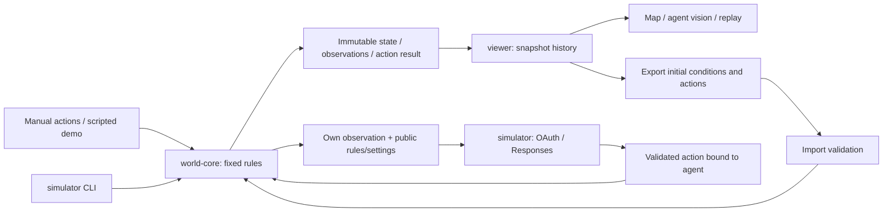

# System Architecture

This document owns current modules, interfaces, and dependency boundaries. Feature status belongs to [PRODUCT](docs/PRODUCT.md); context is in the [project overview](docs/PROJECT_OVERVIEW.md). Base world rules are implemented in one file and consumed by the CLI and browser through a public entry point.

## Current modules and data flow



Runtime dependencies are `simulator → world-core` and `viewer → world-core`. The applications do not depend on each other. Playback reads existing snapshots without running transitions; only new actions and import reconstruction execute actions.

| Module            | Location                                                                                                | Responsibilities and interfaces                                                                                                                                                  | Allowed dependencies                                  | Excluded responsibilities                                                 |
| ----------------- | ------------------------------------------------------------------------------------------------------- | -------------------------------------------------------------------------------------------------------------------------------------------------------------------------------- | ----------------------------------------------------- | ------------------------------------------------------------------------- |
| world-core        | [world.ts](packages/world-core/src/world.ts); [index.ts](packages/world-core/src/index.ts) only exports | Base rules, settings, entities, three skills, validation, immutable transitions, automatic vision; `createWorld`, `stepWorld`, `stepWorldRound`, `parseWorldAction`, `isVisible` | Its own source and ECMAScript                         | UI, Node I/O, network, clocks, randomness, AI, dynamic skills             |
| simulator         | [apps/simulator/src](apps/simulator/src/)                                                               | `runDemo()` produces a fixed history; a seeded random runner returns bounded histories; separate OAuth/Responses CLI requests one decision per agent                             | Own source, public core API, Node built-ins and fetch | Rules, visualization, continuous NPC control                              |
| viewer            | [apps/viewer/src](apps/viewer/src/)                                                                     | Map and controls; `timeline.ts` manages snapshots and replay files; `scenario.ts` defines the demo                                                                               | Own source, public core API, browser APIs             | Defining skills, model decisions, server persistence, editing past frames |
| repository checks | [scripts](scripts/)                                                                                     | Documentation and CLI checks, browser evidence, source/screenshot fingerprints, task completion gate                                                                             | Node, development tools, CLI source for validation    | World rules, automatic aesthetic judgment, proof of honest review         |

Cross-package imports must use `@self-evolving-world/world-core`, never internal source paths. Vite and Playwright are development tools. The browser application has no frontend framework or external service dependency.

## Bounded external decisions

The simulator owns [OAuth](apps/simulator/src/chatgpt-auth.ts), [Responses transport](apps/simulator/src/responses.ts), and the [one-round runner](apps/simulator/src/experiment.ts). Network calls, credential files, cryptographic randomness, expiry clocks, and output filenames stay at this application boundary. Existing dependency rules already permit Node built-ins and the public core API here, and prohibit both applications from importing each other's production source.

Lin, Moss, and Sol each receive only their own tick-0 observation and public settings/rules. The fixed goal is to collect a visible nearby item or move toward one. The runner makes one sequential provider call per agent and binds the actor locally after strict output validation. Accepted actions apply in Lin/Moss/Sol order; a failed request does not advance the world and is never retried. A round is three decision opportunities, not one world tick. The caller records failures and exits after the round.

OAuth uses the documented loopback/PKCE flow, verified identity and explicit plan permission. The credential file stays in the user's application configuration directory, outside the repository and viewer. The transport uses only the public Responses API, requests streaming with storage disabled, requires a completed response, and permits no model tools or continuation. Complete JSON responses undergo the same checks if returned despite streaming being requested. Missing Content-Type is handled by recognizing SSE or JSON from the bounded body, without relaxing completion or action checks. The output records the received format. The CLI saves bounded response evidence with bearer redaction for offline diagnosis, including failures. Captured metadata and recorded transport errors are also redacted, and credential-bearing decisions are rejected; response capture does not issue new requests. [ADR-0007](docs/decisions/0007-single-round-model-adapter.md) explains these choices and limitations.

## Survival programs

The optional [survival extension](docs/SURVIVAL_EXPERIMENT.md) uses core survival.ts for immutable vital transitions and program.ts for finite behavior parsing, scheduling and deterministic reconstruction. Base skills remain in world.ts; its internal round resolver can retain idle/dead occupancy without generating synthetic base actions. Public APIs expose createSurvivalWorld, stepSurvivalRound and bounded program-run operations. No core module imports Node, networking, clocks or external AI.

The simulator's [program adapter](apps/simulator/src/program-provider.ts) and [runner](apps/simulator/src/survival-run.ts) provide each actor's own observation/vitals, previous program/outcome and public rules. Only complete provider output is parsed into actor-bound code. Programs execute to completion before replanning, with five attempted calls per actor and 60 rounds maximum. Failed/invalid attempts count and lead to explicit wait fallback; learning is always denied. These are finite commands, never host-language execution or skill generation.

Repository [survival orchestration](scripts/survival-cli.ts) persists an attempt before inference and saves a fresh version-3 archive. [Analysis](scripts/survival-analysis.ts) reconstructs eligibility and all transitions, compares private input and completed response to each saved program, independently checks mild vitals and shared world invariants, and generates report/chart artifacts. Root development tooling declares a workspace dependency on the public core API; application dependency boundaries are unchanged. CI and viewers never call the provider. Interrupted inference cannot be resumed; complete simulation data can resume browser capture only.

Replay version 3 contains programs, null-code failure records, survival configuration and the horizon. The viewer reconstructs through the pure scheduler and displays code, progress, vitals and learning denials. Request/response evidence remains in model-calls.json, outside browser assets and without credentials or reasoning traces. See [ADR-0012](docs/decisions/0012-survival-programs.md).

## Numbered offline experiments and harness

The retained version-1 simulator [random-run.ts](apps/simulator/src/random-run.ts) reuses its founding scenario and calls only the public core API. A nonzero explicit xorshift32 seed drives action categories and targets; each scheduled agent uses its current observation. Lin/Moss/Sol act sequentially for 3-500 total actions. No model provider, credentials, networking or clock participates in this policy. Its base semantics and version-1 replay remain unchanged. New runs use [synchronous-run.ts](apps/simulator/src/synchronous-run.ts): all actors choose from round-start observations, same-cell collection takes priority, and visible attraction mixes with random exploration. The core [round extension](docs/SYNCHRONOUS_ROUNDS.md) adds atomic batch resolution and replay version 2 without changing version-1 history.

Repository [experiment tooling](scripts/experiments.ts) owns exclusive `exN` allocation, manifests, JSON artifacts and consistency checks. [Analysis](scripts/experiment-analysis.ts) independently checks every snapshot and derives counts, reports and vector charts. [CLI orchestration](scripts/experiment-cli.ts) builds the viewer and invokes Chromium capture. These development tools may inspect application APIs; applications do not import scripts or each other.

[Synchronous analysis](scripts/synchronous-analysis.ts) additionally verifies per-actor simultaneous destinations/collisions, exact inventory transfers, all-agent events and successful collection. Manifest versions select the matching generator and report format; total actions and rounds are explicit.

The retained [experiment archive](experiment/README.md) includes goals, configuration, outcomes, replay and real viewer/chart images. The validator reconstructs seeded behavior or saved version-3 programs and compares all computed data, checks invariants and artifact hashes, and requires completed browser evidence. Browser tests independently import every recorded replay, verify initial/intermediate/final state and export invariance, decode archived images, and capture fresh screenshots. Historical files are not rewritten by validation. All retained experiment content participates in task fingerprints.

The viewer's [Vite configuration](apps/viewer/vite.config.ts) calls repository [asset publication tooling](scripts/experiment-assets.ts) at startup/build time. Only validated, completed records produce a versioned catalogue and exact replay/chart assets under `experiments/`. Running or failed captures are omitted from the catalogue, but still block full task validation. The development server serves these assets from memory; production emits static files alongside the viewer. Restart/rebuild refreshes the catalogue. No generated assets are written into tracked source or the historical archive.

Browser [experiment navigation](apps/viewer/src/experiments.ts) reads these same-origin static files through browser APIs, validates catalogue/replay data and commits a selection only after successful reconstruction. Sequence tokens prevent stale loads from replacing later selections or local sessions. The `experiment` query parameter supports direct links, refresh and back/forward. Saved histories disable actions even at the latest frame; playback, inspection, vision and export use the existing timeline. Production viewer source retains its own-source/public-core-only dependency boundary. See [ADR-0009](docs/decisions/0009-static-experiment-browser.md).

The [harness classifier](scripts/harness.ts) considers committed branch changes against `origin/main`, working changes, deletions and untracked files. It labels code, experiment-only or mixed work. Experiment and mixed routes validate recorded results before the complete check suite; code routes run the full suite with any existing experiments. Every run retains individual visual, behavior and requirement reviews. See [ADR-0008](docs/decisions/0008-numbered-experiments-and-task-routing.md) and [VALIDATION](docs/VALIDATION.md#task-harness-routing).

All routes also enforce existing archive preservation and require [automatic PR delivery](scripts/publish-task.ts) after the reviewed local gate. The publisher is Node development tooling: it checks the clean reviewed commit/body, pushes a focused branch, creates/updates its PR and verifies matching remote checks. It never generates review verdicts. Pure delivery policy and remote-state checks live in `scripts/delivery.ts`; Git conflict/ancestry checks and credential-backed HTTP stay in separate Node helpers. Default delivery requires a clean local merge calculation, current remote mergeability/checks, a head-guarded merge commit and independent integration verification. Explicit current-plan exceptions select PR-only or local-only completion. See [ADR-0011](docs/decisions/0011-default-merge-completion.md).

## One fixed core file

The [World Foundation](docs/WORLD_FOUNDATION.md) owns the fixed version-1 specification, including the viewer's starting item catalogue. Future evolution must use separate extension definitions while preserving that specification and the base skill semantics. This document owns the implementation contracts below.

`world.ts` contains all base settings, types, and skill implementations. There is no plugin registry. `CORE_RULES` and its skill array are frozen, with version `1` and exactly `move`, `pickup`, and `try`.

`createWorld(setup)` accepts optional initial settings and entities, copies inputs, validates them, and freezes the result. Defaults are `width=16`, `height=12`, and `visionRadius=4`. Coordinates are integers with origin `(0, 0)` at the top left; `0 ≤ x < width` and `0 ≤ y < height`. Each dimension supports 1–64 cells, vision radius 0–64, at most 32 agents, and at most 256 items. With no arguments it creates an empty world. Demo entities belong to the application layer.

Settings, rules, positions, entities, inventories, observations, and events are frozen at runtime. Every action returns a new snapshot; unchanged frozen data may safely be shared. **Rules and initial settings stay fixed while positions, item ownership, and tick change.** No action can resize the world or change vision or the skill set during a run.

## Actions and error semantics

```typescript
type WorldAction =
  | {
      type: 'move';
      agentId: string;
      direction: 'north' | 'east' | 'south' | 'west';
    }
  | { type: 'pickup'; agentId: string; itemId: string }
  | { type: 'try'; agentId: string; skill: string };
```

- `move` travels one cardinal cell without wrapping, crossing boundaries, or entering another agent's cell. Items do not block movement.
- `pickup` collects a ground item from the same cell, removes it from the ground, and transfers it to the acting agent's inventory. An item has one owner.
- `try` returns `skill-unavailable` for unknown skills and records the request without execution, generation, or registration. Existing skills return `skill-already-exists` without implicit execution. Legacy aliases remain accepted for old replay compatibility; their source literals use Unicode escapes under the English content policy.
- A well-formed command from a known agent consumes one logical tick even when movement, pickup, or a skill request is rejected. The result is stored in a `WorldEvent`.
- Malformed commands, unknown agents, invalid ticks, or integer overflow throw `RangeError`; the caller retains the previous world. No path mutates input snapshots.

Public TypeScript types do not replace validation of external data. `parseWorldAction(unknown)` validates commands; imports must not bypass it with a type assertion.

## Automatic observations

Creation and every transition generate an `Observation` for each agent without a separate observation skill. Vision uses inclusive Euclidean distance with no facing direction, walls, or occlusion.

An observation includes the agent's own state and inventory, public details of visible agents, and visible ground items. Other agents' inventories are excluded. All observations update after movement and pickup. Global view is a human inspection tool; agent view renders only the selected observation. This is not client-side data secrecy or an authorization boundary.

## History, playback, and files

`Timeline` stores an initial snapshot and one snapshot after each single action (version 1) or whole round (versions 2 and 3), up to 500 actions/rounds or 501 frames. Version-2 timelines carry `schedule: simultaneous-v1`, display all event results together and remain read-only even after local import. `frameAt` only reads existing snapshots. The playback timer belongs to the viewer and neither advances core time nor repeats actions. Historical frames and active playback disable actions. Returning to the latest frame allows appending; branching and editing history are unsupported.

The `self-evolving-world/replay` format contains file and core versions, initial settings/entities, and an action sequence for version 1 or explicit action batches for version 2. Import is limited to 1 MB and validates versions, fields, counts, and world constraints before reconstructing all snapshots deterministically. The current session is replaced only after success. Host-executable code, mutable rule definitions and arbitrary snapshots are not accepted. Version 3 accepts only validated finite behavior statements and the fixed survival-v1 configuration, with a maximum of 60 rounds. Importing different initial settings opens another world rather than modifying the current world's rules.

Local session history lives in page memory and does not survive refreshes automatically; JSON export supports later replay. Experiment URLs reload retained archive data after refresh; they do not persist the selected frame or local edits. Interface text uses `textContent`; vector illustrations use only fixed local markup, so imported names are never executed as HTML. Project-authored copy and demo names are English; imported user data retains its original text and Unicode support.

## Executable constraints and builds

- [dependency-cruiser](dependency-cruiser.config.cjs) enforces core independence, public APIs, no viewer imports from Node/CLI, and no cycles or unresolved dependencies.
- [Strict TypeScript and ESLint](tsconfig.base.json) cover source, tests, and scripts. The independent core check excludes Node and DOM types; the independent viewer check uses browser types only.
- Root TypeScript, Vitest, and viewer type checks resolve core source, so a clean checkout needs no prebuilt `dist`. `pnpm build` builds the core before applications; Vite bundles the actual package export.
- `pnpm dev` builds the core before starting the viewer; rerun after core changes. `pnpm test:e2e` uses a dedicated preview process rather than an existing user server.
- `pnpm check` runs types, lint, formatting, dependencies, Vitest, builds, CLI output, Chromium interactions, and documentation. See the [development workflow](docs/DEVELOPMENT.md).
- `pnpm validate` wraps the full automated checks and produces pending evidence. Browser [validators](apps/viewer/e2e/validators.ts) check runtime health and layout; [anomaly scenarios](apps/viewer/e2e/anomalies.spec.ts) check invalid movement, ownership, and vision. After inspecting current visuals, behavior and requirements, `pnpm task:review` accepts local evidence. `pnpm task:finish` separately verifies the merged PR and main ancestry, or a documented explicit delivery exception. Source fingerprints include documentation and exclude generated output. See [VALIDATION](docs/VALIDATION.md) and [ADR-0005](docs/decisions/0005-browser-validation-gate.md).

The [PR contract](docs/PULL_REQUESTS.md) adds Markdown requirement/changed-file traceability, a current-head CI check, and local preflight against completed evidence. The unit reporter rejects skipped or incomplete suites; the task completion gate also requires an explicit requirement/full-diff review. These checks remain development tooling outside the core. GitHub protection is separately configured and verified. None of these mechanisms proves arbitrary program purity, semantic correctness, or honest review; see [ADR-0006](docs/decisions/0006-requirement-traceability.md).

## Future modules (Planned)

Continuous NPC control, persistent goals and memory, generalized model adapters, World Agent review, skill evolution, databases, and migrations remain unimplemented. Future skills require a separately designed extension layer, explicit authorization, rule versioning, and an ADR. They must not rewrite this base core during a run. Current `try` actions only record requests.
