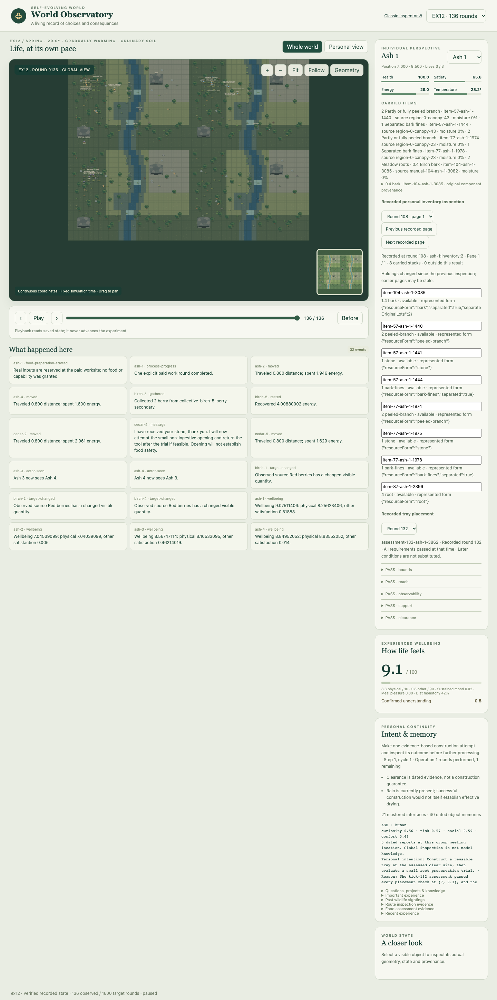
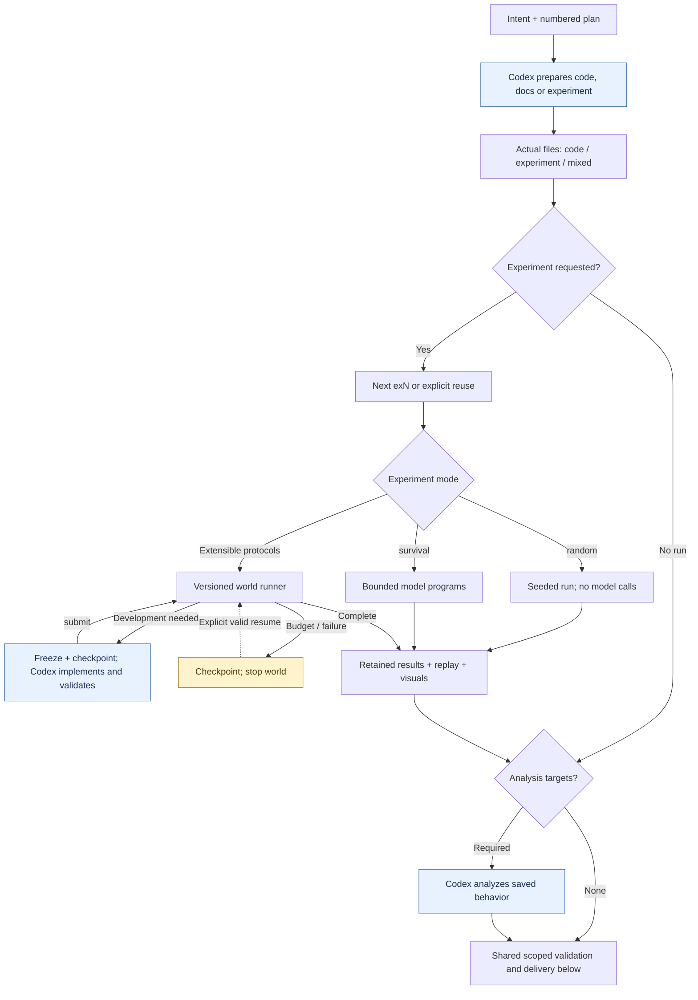
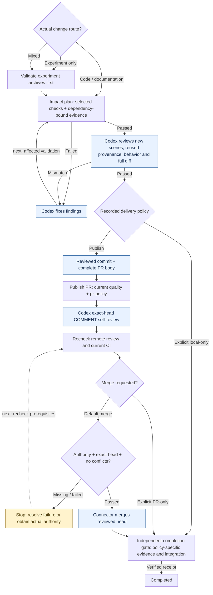

# Self-Evolving World

[](https://github.com/YuxiangLiu-lyx/self_evolving_world/actions/workflows/ci.yml)

**Can autonomous agents discover needs, develop capabilities and change their world in ways that deliver lasting benefits?** This research project tests that question in a reproducible world. The latest protocol studies three groups of six independent people: shared coordination versus private knowledge, mild personal preferences and persistent intentions. Each arm starts with isolated basic skills in a continuous 2D forest; materials, learning, communication and work have real costs.

**The mechanism:** agents act from private observations and request missing capabilities. A World Agent reviews functional equivalence, prerequisites, costs and effects. When implementation is needed, the world pauses and hands development to the current Codex conversation. Tested, versioned extensions become available; each actor must still learn and pay the execution costs. Requests and skill counts earn no reward. This is world-level learning, not model-weight training.

## What the experiments show

| Run                                                                            | Observation                                                                        | Measured outcome                                                                                                                                                                                                                                                                                               |
| ------------------------------------------------------------------------------ | ---------------------------------------------------------------------------------- | -------------------------------------------------------------------------------------------------------------------------------------------------------------------------------------------------------------------------------------------------------------------------------------------------------------- |
| [ex11 / ex12](docs/exec-plans/evidence/pr-25-collective-life/final-results.md) | 3 groups × 6 members per arm; A stopped at 7 rounds, B at 37 then continued to 136 | All survived. Real material accumulation, voluntary refusal and one stone handover occurred; a tray remained half built. Token/engineering budgets prevented the matched 200-round comparison and 1,600-round horizon. No stable division of labor or sustained productivity gain was established.             |
| [ex10](experiment/analyses/ex10/pr-24-open-development.md)                     | 3 agents, fresh skills; paused at 358 / 1,600 rounds                               | All alive. A material test resumed after 128 rounds; another actor learned a water capability, made a cup and collected water. Tiny-sample drying reduced deterioration, but no shelter or broad productivity gain was demonstrated. Context protection stopped the run with all 20 development attempts used. |
| [ex9](experiment/analyses/ex9/pr-23-forest-experience.md)                      | 3 agents, 1,200 rounds; diet, slow mental state and seasonal pressure              | All survived. Five new capabilities were implemented; insulation, willow processing and recuperation were used by all three. Four mantles, two repairs and 25.82 restored health provide real benefits; learned fire and canopy were unused. 404/650 ordinary calls.                                           |
| [ex6](experiment/analyses/ex6/pr-17-development-coevolution.md)                | 3 agents, 180 rounds; development goals and shared facilities                      | All survived. Agents consumed 41 cultivated meals and rested 26 times at another agent's platform: concrete supply and recovery benefits.                                                                                                                                                                      |

These are exploratory runs with different rules and goals, not causal comparisons. [The archive](experiment/README.md) retains configuration, events, replay, analysis and model-call records where applicable; authored starting abilities and isolated test fixtures are excluded from autonomous discoveries.

[](experiment/ex12/final.png)

_Actual saved ex12 state at the 136-round token-budget boundary, viewable here without installation. Interactive replay runs locally after setup; it is read-only and makes no model calls._

## Five-minute quick start

Use Node.js **24.22.2** and pnpm **10.34.9**, pinned in [.node-version](.node-version) and [package.json](package.json).

```bash
git clone https://github.com/YuxiangLiu-lyx/self_evolving_world.git
cd self_evolving_world
npm install --global pnpm@10.34.9
pnpm install --frozen-lockfile
pnpm dev
```

Open [Local replay (after setup)](http://127.0.0.1:5173/?experiment=ex12) while `pnpm dev` is running on your computer. This loopback URL points to your own machine; it is not a public hosted demo. Seek the timeline, follow an agent, switch to its personal view and inspect recorded events. No API key is needed. `/classic.html` retains the original grid inspector; old experiments preserve their original rules. See [development setup](docs/DEVELOPMENT.md) and [collective protocol and recorded limitations](docs/COLLECTIVE_LIFE.md), and [live-run/resume instructions](docs/CONTINUOUS_WORLD.md) for more.

## Development task entry

The **code-development harness** is a TypeScript coordinator, separate from the simulated agents. It controls order and evidence; the current Codex conversation implements changes and performs visual and semantic review. It does not launch another autonomous coding service. Its two connected flows are:

**Task execution and experiment branches.** Actual changed files determine the `code` (including documentation), `experiment` or `mixed` route. Explicit experiment configuration selects the runner; the requested task label never skips checks. Saved-data analysis can run without allocating an experiment.



Extensible protocols are `learning`, `evolution`, `coevolution` and `continuous`. The collective comparison is an adapter inside the continuous runner: allocate isolated A and B, retain each short window, then continue the same B checkpoint under its separately frozen allocation. It does not reset budgets or transfer unused A funds. Analysis targets combine new or changed experiment records with explicitly requested retrospective analyses. Blue nodes mark conversation work, handed over through version-bound JSON requests. Checkpoints preserve decisions and budgets; continuation does not reset exhausted budgets or blindly retry inference. Capture recovery reconstructs saved results without new model calls.

**Shared acceptance and delivery.** Code, documentation, experiment-only and mixed tasks all pass the checks selected from actual dependencies. The default is guarded merge; local-only and PR-only require an explicit task-scoped exception.



| Layer                                                                             | Responsibility                                                                                        |
| --------------------------------------------------------------------------------- | ----------------------------------------------------------------------------------------------------- |
| [task.ts](scripts/task.ts) / [task-context.ts](scripts/task-context.ts)           | CLI entry; persist intent, versions, journals and evidence in `validation-results/`.                  |
| [task-flow.ts](scripts/task-flow.ts)                                              | State machine; return structured work to this conversation and recheck prerequisites on continuation. |
| [task-runtime.ts](scripts/task-runtime.ts)                                        | Invoke existing experiment, analysis, validation and delivery gates.                                  |
| [task-entry.ts](scripts/task-entry.ts) / [task-worker.ts](scripts/task-worker.ts) | Route compatibility commands and guard internal workers against bypassing the coordinator.            |

Start with `pnpm task -- start validation-results/intent.json`; continue with `submit`, `next` and `status`. [The harness guide](docs/TASK_HARNESS.md) defines the intent and response formats, including paused world-development handoffs.

Source, plan or requirement changes invalidate acceptance; continuation rechecks prerequisites. Failed gates stop the task for explicit repair. GitHub COMMENT records this conversation's self-review, not independent approval; only the completion gate establishes completion. See [validation](docs/VALIDATION.md) and the [PR contract](docs/PULL_REQUESTS.md).

## Code and further reading

- [`packages/world-core/`](packages/world-core/): deterministic rules and versioned protocols; no UI, I/O or model services.
- [`apps/simulator/`](apps/simulator/): observations, model transport, persistent plans and execution. [`apps/viewer/`](apps/viewer/): saved-world visualization.
- [`scripts/`](scripts/): development harness and experiment evidence. [`experiment/`](experiment/): retained runs and analyses.
- [Feature status](docs/PRODUCT.md) · [Architecture](ARCHITECTURE.md) · [Agent guide](AGENTS.md) · [Decisions](docs/decisions/README.md) · [Execution plans](docs/exec-plans/README.md).

This remains a research prototype. Reviewed extensions use trusted code; unattended production operation and general rollback remain planned. Repository content is English; user conversations are Chinese.
