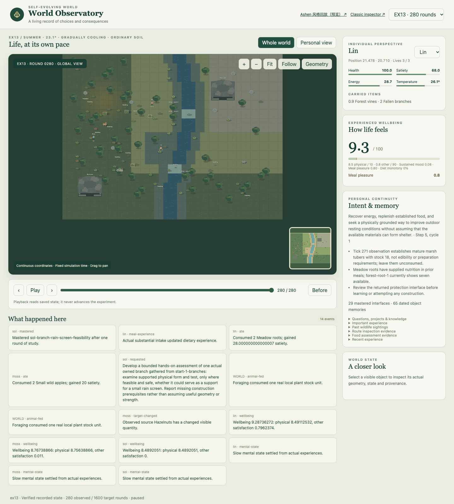

# Self-Evolving World

[](https://github.com/YuxiangLiu-lyx/self_evolving_world/actions/workflows/ci.yml)

**Can autonomous agents discover what they need, develop new capabilities and change their world in ways that deliver lasting benefits?** This research project studies that question in a reproducible simulated world.

Model-driven people live in a continuous 2D forest with finite food, materials, weather and finite lives. They start with a few basic skills and act only on private observations. Materials, learning, communication and work all cost something. When someone needs a capability that does not exist, they request it. A World Agent reviews the request's functional equivalence, prerequisites, costs and effects. If code is needed, the world pauses while a coding agent implements, tests and versions the extension. Each person must still learn it and pay to use it. Requests and skill counts earn no reward. This is world-level learning, not model-weight training.

## Results so far

| Run                                                                            | Setup                                                     | Outcome                                                                                                                                                                           |
| ------------------------------------------------------------------------------ | --------------------------------------------------------- | --------------------------------------------------------------------------------------------------------------------------------------------------------------------------------- |
| [ex13](docs/exec-plans/evidence/pr-31-long-open-development/final-results.md)  | 3 agents, bounded context; paused at 280 / 1,600 rounds   | All alive. Paid material trials formed short dependency chains, and one agent tested and then ate apples. The 40-development cap stopped the run. No sustained productivity gain. |
| [ex11 / ex12](docs/exec-plans/evidence/pr-25-collective-life/final-results.md) | 3 groups × 6 members per arm; stopped at 7 and 136 rounds | All survived. Real material accumulation, voluntary refusal and one stone handover occurred; a tray stayed half built. No stable division of labor.                               |
| [ex10](experiment/analyses/ex10/pr-24-open-development.md)                     | 3 agents, fresh skills; paused at 358 / 1,600 rounds      | All alive. One agent learned a water capability, made a cup and collected water. Small-sample drying reduced deterioration. No shelter.                                           |
| [ex9](experiment/analyses/ex9/pr-23-forest-experience.md)                      | 3 agents, 1,200 rounds; diet, mood and seasons            | All survived. Five capabilities were implemented. Insulation, willow processing and recuperation were used by all three; fire and canopy went unused.                             |
| [ex6](experiment/analyses/ex6/pr-17-development-coevolution.md)                | 3 agents, 180 rounds; projects and shared facilities      | All survived. Agents ate 41 cultivated meals and rested 26 times at another agent's platform.                                                                                     |

These are exploratory runs with different rules, not causal comparisons. [The archive](experiment/README.md) keeps every run's configuration, events, replay, model calls and behavioral analysis.

[](experiment/ex13/final.png)

_The saved ex13 world at round 280._

## Quick start

Use Node.js **24.22.2** and pnpm **10.34.9** (pinned in [.node-version](.node-version) and [package.json](package.json)).

```bash
git clone https://github.com/YuxiangLiu-lyx/self_evolving_world.git
cd self_evolving_world
npm install --global pnpm@10.34.9
pnpm install --frozen-lockfile
pnpm dev
```

Open <http://127.0.0.1:5173/?experiment=ex13> to replay a saved run locally. You can seek the timeline, follow an agent, switch to its personal view and inspect events. Replay is read-only, needs no API key and makes no model calls. `/ashen.html?experiment=ex13` and `/ashen.html` (ex9) are close-follow presentation views; see the [ex13](docs/presentation/ex13/README.md) and [ex9](docs/presentation/ex9/README.md) guides. `/classic.html` replays the early grid experiments.

## Repository

- [`packages/world-core/`](packages/world-core/): deterministic rules and versioned protocols, with no UI, I/O or model services.
- [`apps/simulator/`](apps/simulator/): observations, model transport, plans and execution. [`apps/viewer/`](apps/viewer/): browser replay.
- [`experiment/`](experiment/): retained runs and analyses. [`scripts/`](scripts/): experiment commands and validation.
- [Project overview](docs/PROJECT_OVERVIEW.md) · [Feature status](docs/PRODUCT.md) · [Architecture](ARCHITECTURE.md) · [Decisions](docs/decisions/README.md) · [Continuous world](docs/CONTINUOUS_WORLD.md)

## Development

Changes go through focused branches and PRs. `pnpm validate` runs only the checks that the changed files require, and CI must pass before merging; experiments always get a fresh, immutable `exN` with a behavioral analysis. See the [development workflow](docs/DEVELOPMENT.md) and the [agent guide](AGENTS.md).

This is a research prototype. Repository content is in English.
