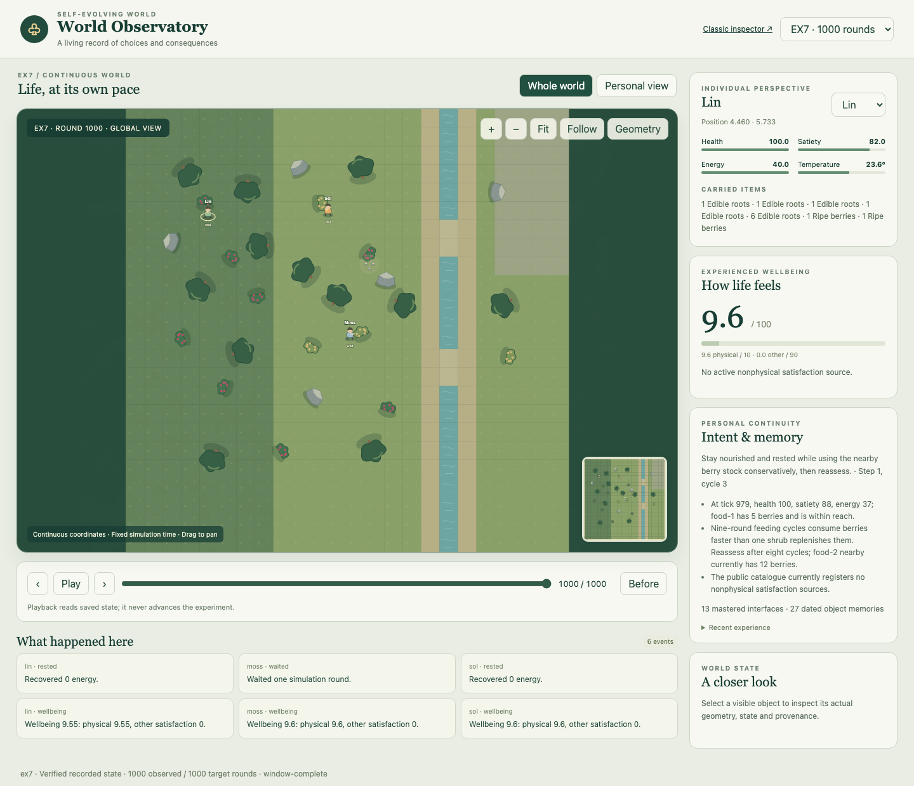
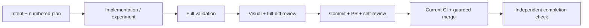

# Self-Evolving World

[](https://github.com/YuxiangLiu-lyx/self_evolving_world/actions/workflows/ci.yml)

**Can autonomous agents discover needs, develop capabilities and change their world in ways that deliver lasting benefits?** This research project tests that question in a reproducible world. The latest protocol combines continuous 2D space, physical costs, persistent objects, individual memory and happiness driven by actual outcomes.

**The mechanism:** agents act from private observations and request missing capabilities. A World Agent reviews functional equivalence, prerequisites, costs and effects. When implementation is needed, the world pauses and hands development to the current Codex conversation. Tested, versioned extensions become available; each actor must still learn and pay the execution costs. Requests and skill counts earn no reward. This is world-level learning, not model-weight training.

## What the experiments show

| Run                                                             | Observation                                                   | Measured outcome                                                                                                                                                                                                                                                                 |
| --------------------------------------------------------------- | ------------------------------------------------------------- | -------------------------------------------------------------------------------------------------------------------------------------------------------------------------------------------------------------------------------------------------------------------------------- |
| [ex7](experiment/analyses/ex7/pr-18-continuous-world.md)        | 3 agents, 1,000 rounds; continuous space and happiness goals  | All survived at full health. Two requested activities were implemented: seven nature observations completed and one persistent stone mosaic was made. Mean happiness stayed at 9.42–9.58/100; mental satisfaction remained zero, with no sustained benefit from either activity. |
| [ex6](experiment/analyses/ex6/pr-17-development-coevolution.md) | 3 agents, 180 rounds; development goals and shared facilities | All survived. Agents consumed 41 cultivated meals and rested 26 times at another agent's platform: concrete supply and recovery benefits.                                                                                                                                        |
| [ex5](experiment/ex5/report.md)                                 | 4 agents, 120 rounds; resource and skill evolution            | Seven shared skills emerged, but all four agents starved. Capability count did not establish usefulness.                                                                                                                                                                         |

These are exploratory runs with different rules and goals, not causal comparisons. [The archive](experiment/README.md) retains configuration, events, replay, analysis and model-call records where applicable; authored starting abilities and isolated test fixtures are excluded from autonomous discoveries.

[](experiment/ex7/final.png)

_Actual saved ex7 state. Replay is read-only and makes no model calls._

## Five-minute quick start

Use Node.js **24.22.2** and pnpm **10.34.9**, pinned in [.node-version](.node-version) and [package.json](package.json).

```bash
git clone https://github.com/YuxiangLiu-lyx/self_evolving_world.git
cd self_evolving_world
npm install --global pnpm@10.34.9
pnpm install --frozen-lockfile
pnpm dev
```

Open [the ex7 demo](http://127.0.0.1:5173/?experiment=ex7). Seek the timeline, follow an agent, switch to its personal view and inspect recorded events. No API key is needed. `/classic.html` retains the original grid inspector; old experiments preserve their original rules. See [development setup](docs/DEVELOPMENT.md) and [live-run/resume instructions](docs/CONTINUOUS_WORLD.md) for more.

## Development task entry

The **code-development harness** is a TypeScript coordinator, separate from the simulated agents. It controls order and evidence; the current Codex conversation implements changes and performs visual and semantic review. It does not launch another autonomous coding service.



| Layer                                                                             | Responsibility                                                                                        |
| --------------------------------------------------------------------------------- | ----------------------------------------------------------------------------------------------------- |
| [task.ts](scripts/task.ts) / [task-context.ts](scripts/task-context.ts)           | CLI entry; persist intent, versions, journals and evidence in `validation-results/`.                  |
| [task-flow.ts](scripts/task-flow.ts)                                              | State machine; return structured work to this conversation and recheck prerequisites on continuation. |
| [task-runtime.ts](scripts/task-runtime.ts)                                        | Invoke existing experiment, analysis, validation and delivery gates.                                  |
| [task-entry.ts](scripts/task-entry.ts) / [task-worker.ts](scripts/task-worker.ts) | Route compatibility commands and guard internal workers against bypassing the coordinator.            |

Start with `pnpm task -- start validation-results/intent.json`; continue with `submit`, `next` and `status`. [The harness guide](docs/TASK_HARNESS.md) defines the intent and response formats, including paused world-development handoffs.

Every PR runs the complete suite, including Chromium. Current screenshot, behavior and requirement reviews bind to the source version. GitHub COMMENT records this conversation's self-review; it is not independent approval. Current `quality` and `pr-policy`, merge authority and verified integration are required for completion. See [validation](docs/VALIDATION.md) and the [PR contract](docs/PULL_REQUESTS.md).

## Code and further reading

- [`packages/world-core/`](packages/world-core/): deterministic rules and versioned protocols; no UI, I/O or model services.
- [`apps/simulator/`](apps/simulator/): observations, model transport, persistent plans and execution. [`apps/viewer/`](apps/viewer/): saved-world visualization.
- [`scripts/`](scripts/): development harness and experiment evidence. [`experiment/`](experiment/): retained runs and analyses.
- [Feature status](docs/PRODUCT.md) · [Architecture](ARCHITECTURE.md) · [Agent guide](AGENTS.md) · [Decisions](docs/decisions/README.md) · [Execution plans](docs/exec-plans/README.md).

This remains a research prototype. Reviewed extensions use trusted code; unattended production operation and general rollback remain planned. Repository content is English; user conversations are Chinese.
