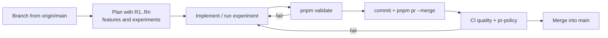

# Development Workflow

## Environment

Use the Node version in [.node-version](../.node-version) and the pnpm version in [packageManager](../package.json); `engine-strict` rejects others. Install Chromium with `pnpm exec playwright install chromium` before browser checks. Pin exact dependencies, commit `pnpm-lock.yaml`, and use `pnpm install --frozen-lockfile` in CI. Root dependencies are development tools; packages declare their own runtime dependencies and use `workspace:*` across packages. Do not commit `dist/`.

User conversations are in Chinese; all repository content is in English ([language policy](../AGENTS.md#language-policy)).

## Workflow

1. **Branch.** Check `git status`, preserve unrelated work and create a focused branch from current `origin/main`. Keep one concern per PR; an experiment PR contains its archive, analysis, plan and directly related documentation.
2. **Plan.** For features and experiments, add `docs/exec-plans/active/pr-NN-short-name.md` with a requirement summary, numbered requirements (`- R1: ...`), scope and exclusions, and acceptance criteria. Small fixes may skip the plan. See [execution plans](exec-plans/README.md).
3. **Implement and validate.** `pnpm validate` derives the checks from the actual diff against `origin/main` ([check selection](VALIDATION.md#check-selection)). Fix failures and rerun; reconstruction and browser results are cached locally by input fingerprint, so unchanged parts are reused. For viewer changes, open the screenshots it lists and look at them. `pnpm validate:audit` runs everything.
4. **Publish.** Commit, write the PR body from the [template](../.github/pull_request_template.md) into `validation-results/pr-body.md`, then run `pnpm pr -- validation-results/pr-body.md "Title" --merge`. It checks the body (`pnpm pr:check`), pushes without force, creates or updates the PR, waits for `quality` and `pr-policy`, and merges with a merge commit. Without `--merge` it stops after opening the PR. Credentials come from `GITHUB_TOKEN` or the Git HTTPS credential helper; the GitHub CLI is not required.

Merging is the default because the user authorized it; an explicit task-level "PR only" or "local only" instruction overrides it. Update [PRODUCT](PRODUCT.md), [ARCHITECTURE](../ARCHITECTURE.md) and [ADRs](decisions/README.md) in the same PR when features, boundaries or decisions change.

## Experiments

See the [experiment archive guide](../experiment/README.md) for formats and analysis.

| Command                                                                                                                                                      | Purpose                                                                                                           |
| ------------------------------------------------------------------------------------------------------------------------------------------------------------ | ----------------------------------------------------------------------------------------------------------------- |
| `pnpm experiment:run -- [seed] [rounds]`                                                                                                                     | Seeded random synchronous run; allocates the next exN and never calls a model                                     |
| `pnpm experiment:login`                                                                                                                                      | Local ChatGPT OAuth for model-calling runs                                                                        |
| `pnpm experiment:continuous -- new open\|long\|long-fixes\|long-culture\|long-culture-incentives\|long-culture-v2\|long-culture-v2-incentives\|collective-a` | Allocate the next exN and run a continuous world until a development barrier or pause                             |
| `pnpm experiment:continuous -- new collective-b exA`                                                                                                         | Second collective arm, reusing arm A's preflighted physical baseline                                              |
| `pnpm experiment:continuous -- develop exN file.json`                                                                                                        | Submit the reviewed development for the pending barrier and continue                                              |
| `pnpm experiment:continuous -- continue exN`                                                                                                                 | Continue a saved checkpoint; uncertain calls are never resent                                                     |
| `pnpm experiment:continuous -- extend exN rounds`                                                                                                            | Preserve the captured window and extend the observation horizon (explicit reuse only)                             |
| `pnpm experiment:continuous -- repair exN [--abandoned-pid PID]`                                                                                             | Turn a technical pause (computation, context, failed long call) into a counted handoff                            |
| `pnpm experiment:capture -- exN`                                                                                                                             | Capture or recapture screenshots and seal a finished simulation without new inference                             |
| `pnpm experiment:analysis -- file.json`                                                                                                                      | Validate and write the companion behavioral analysis                                                              |
| `pnpm experiment:check` / `pnpm analysis:check`                                                                                                              | Check archive integrity and companion analyses                                                                    |
| `pnpm metrics:long -- experiment/exN [rounds]`                                                                                                               | Cost and development metrics of a long-development archive, optionally before a round                             |
| `pnpm compat:long -- experiment/exN --write\|--compare digest.json`                                                                                          | Fingerprint retained requests and paused inputs before and after a protocol or prompt change                      |
| `pnpm metrics:culture -- experiment/exN [rounds] [--markdown file]`                                                                                          | Rule-based public culture metrics of a continuous-family archive and a separate owner-only private-memory section |

When a continuous run reaches a development barrier, the command prints the barrier and exits. The current conversation implements the requested mechanism (see [Continuous World](CONTINUOUS_WORLD.md) and [Long Development](LONG_DEVELOPMENT.md)) and submits it with `develop`; the declaration names its `developer` (`current-claude-conversation` for Claude Code). Do not change controller, transport or policy source during a saved run; the source verifier rejects it. A finished window is captured automatically. Then write the analysis, run `pnpm validate` and publish.

Grid-era protocols (random v1, survival, learning, evolution, coevolution) remain replayable and validated, but new runs of them are retired; only seeded random runs and continuous scenarios can start.

## Debugging failures

`pnpm check` runs typecheck → lint → format → architecture → test → build → experiment:check → analysis:check → test:e2e → docs and stops at the first failure. `pnpm format` fixes formatting only. If engine checks fail, switch to the pinned Node and pnpm versions instead of disabling `engine-strict`. Do not disable rules or delete tests to make CI pass.

Tests resolve source aliases without a build. The core and viewer also have independent type checks; production builds resolve real package exports.

## Version control and CI

The canonical repository is [YuxiangLiu-lyx/self_evolving_world](https://github.com/YuxiangLiu-lyx/self_evolving_world); `origin` is `https://github.com/YuxiangLiu-lyx/self_evolving_world.git` and `main` is the integration branch. Do not force-push shared history or commit dependencies, build outputs or credentials.

[CI](../.github/workflows/ci.yml) runs `pnpm validate` as the `quality` job on PR commits and main pushes, deriving its plan from the event's base SHA; a manual dispatch runs the full audit. [pr-policy](../.github/workflows/pr-policy.yml) checks the PR description. Reports and screenshots are uploaded as `validation-<sha>-<attempt>` for 14 days. Branch protection (see the [PR contract](PULL_REQUESTS.md#github-checks-and-merge-restrictions)) requires both checks on an up-to-date branch.

## Viewer development

`pnpm dev` builds the core and starts Vite. Browser changes reload automatically; restart after changing the core or finishing an experiment. The Vite configuration checks completed archive integrity without deep reconstruction and serves the catalogue, replays and charts. `pnpm build && pnpm test:e2e` runs the Playwright suite against a preview server on port 4173. Screenshots and traces go to ignored `test-results/`, the HTML report to `playwright-report/`, and validation reports to `validation-results/`.

If the shell cannot find pnpm, follow the [quick start](../README.md#quick-start) and verify `pnpm --version` in a fresh shell.

Base world behavior stays in `world.ts`. Rule changes require explicit versioning, replay compatibility decisions, ADR updates and tests. Never connect `try` directly to arbitrary code execution.
