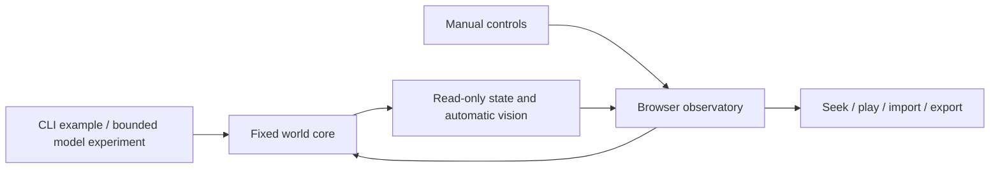

# Project Overview

## Vision

Self-Evolving World explores how autonomous agents might interact in a shared world and how world capabilities could evolve under controlled review. Humans own product direction, rules, and acceptance; Codex helps implement the system. Future autonomous NPCs are distinct from the coding agent.

The current focus is a stable, understandable foundation: base rules stay fixed during a run, and every state transition can be observed and replayed.

## How the world runs

The world is a bounded two-dimensional grid, 16×12 by default, with origin `(0, 0)` at the top left. Agents have names, positions, and inventories. Items start on the ground. World dimensions and vision radius are configured at creation and remain fixed.

In the original single-action API, each well-formed action from a known agent advances the logical tick by one. Successful actions, boundary collisions, and unsupported skill attempts all leave records. A tick counts actions, not elapsed seconds. An optional CLI experiment requests one model decision per founding agent and then stops; the browser never starts model requests.

New offline experiments use the [simultaneous-round extension](SYNCHRONOUS_ROUNDS.md): all agents choose from their own round-start observations and commit together. One tick is one complete round; results distinguish rounds from total actions. Existing single-action demos and ex1 retain their original semantics.

## Three base skills

- **Move:** travel one cell north, east, south, or west without leaving the world or entering another agent's cell.
- **Pick up:** transfer an item from the agent's current cell to its inventory. The item leaves the ground and is not duplicated.
- **Try:** request an unavailable skill such as `fly`. The world records an unavailable result without executing or unlocking it.

Agents automatically observe other agents and ground items within an inclusive circular radius, 4 cells by default. There are no obstacles or occlusion. Observation consumes no action and updates after every transition.

## Fixed rules and changing state

The [World Foundation](WORLD_FOUNDATION.md) records the permanent starting item catalogue, base skills, and environment. It is not updated with live inventories or future discoveries; evolution must keep extensions separate.

Base settings, types, and skills are concentrated in [world.ts](../packages/world-core/src/world.ts). Rules, settings, and all snapshots are frozen. Actions produce new snapshots without changing history.

Agents can move, collect items, and submit requests while the rules remain fixed. They cannot resize the world or add skills during a run.

## Main modules

- The **core** owns rules and transitions, with no UI, networking, or AI service dependency.
- The **CLI** runs a fixed demo, a [seeded random experiment](../experiment/README.md) without external agents, or the separately invoked [one-round model experiment](ONE_ROUND_EXPERIMENT.md). The model experiment submits each agent's own observation to ChatGPT and validates its returned action before applying it.
- The **observatory** displays the map, inventory, vision, and results, and supports interaction and replay. It loads a 12-action demo with three agents, then allows manual continuation.

Module contracts are in [ARCHITECTURE](../ARCHITECTURE.md). Current feature status and evidence are maintained only in [PRODUCT](PRODUCT.md#current-scope).

## Observing and replaying

Start the viewer using the [quick start](../README.md#five-minute-quick-start). Select an agent on the map or from the dropdown. Global view shows the whole world; agent vision hides entities outside the selected observation. The inspector always shows that agent's inventory and observation at the current frame.

Use direction buttons or WASD to move, then collect items from the same cell. The current interface exposes move and pickup; legacy try records remain readable without a learning-attempt control. The timeline supports play, pause, speed changes, stepping, and seeking. Actions are disabled in historical frames; select **Latest frame** to continue.

Use **Experiment archive** to select a retained run such as **ex2** or **ex1**. The page opens its full interactive timeline, objective, seed and overview chart without file import. Its `?experiment=ex1` URL restores the archive after refresh and supports browser navigation. Archived histories remain read-only at every frame. New runs appear after restarting development or rebuilding the static viewer.

Export stores initial conditions and actions. Import reconstructs history under the same rules version. Local session memory is not automatically persisted across refreshes, so export before leaving. Invalid imports or experiment loads preserve the current world. **Demo / local session**, **New world** and valid file imports leave archive mode.

## NPC Agent (Planned)

Existing entities have positions, inventories, and vision. The optional model experiment adds a single decision opportunity per agent to scripts and manual input. Future NPCs would have persistent goals, memory, and a continuous decision loop; those capabilities are outside this experiment.

## World Agent (Planned)

A future World Agent would assess capability requests for suitability, compatibility, permissions, and validation. It would not automatically gain permission to edit production code or execute arbitrary code. No such reviewer currently exists.

## Skill Evolution (Planned)

Future requests may become capabilities through specification, review, isolated testing, and versioning. Current `try` actions only record unavailable names. There is no code generation, sandbox, dynamic registration, activation, or rollback. Attempts do not change the base core.

## Limitations and next steps

There is no terrain collision, occlusion, diagonal movement, continuous physics, trade, or coordinated autonomous decision-making. The browser stores at most 500 single actions or simultaneous rounds in memory and accepts replay files up to 1 MB. There is no database, autosave, long-running service, or cross-version migration.

Any expansion beyond one round needs a separate decision on goals, scheduling, memory, and account usage. The scripted demo must not be presented as model behavior, and attempts must not execute new code without a separate validation and governance design.
