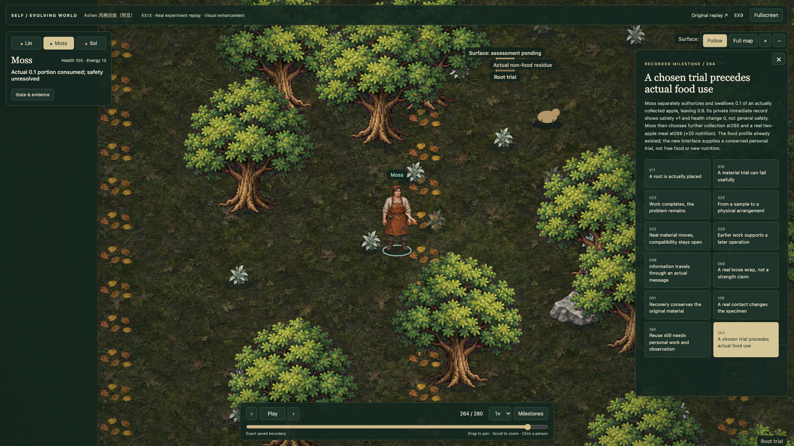

# EX13 Ashen-style presentation

This independent view reads the real ex13 archive. It never runs an agent, advances
the simulated world or changes a record. EX9 remains the default Ashen entry and
all original replay/analysis pages remain available.

```bash
pnpm install --frozen-lockfile
pnpm dev
```

Open [EX13 local replay after setup](http://127.0.0.1:5173/ashen.html?experiment=ex13).
This address points to the viewer's own computer; it is not a hosted public demo.
The page identifies the archive as **EX13 · Real experiment replay · Visual enhancement**.
Follow a person, drag to suspend follow, zoom, switch to overview, pause, step,
change speed, or open the bookmark drawer. Returning to the original replay keeps
the same experiment and recorded round.

## Event-bound navigation

The [story metadata](story.json) binds each bookmark to an actual event type and
actor. These are observations of the formal run, not isolated test outcomes.

| Round | Person | What the record establishes                                                                           | What it does not establish                                        |
| ----- | ------ | ----------------------------------------------------------------------------------------------------- | ----------------------------------------------------------------- |
| 11    | Moss   | Paid placement of an actual root in a persistent trial                                                | Growth, reproduction or harvest                                   |
| 19    | Sol    | A consumed moss sample fails a tested load                                                            | Useful bedding or resting benefit                                 |
| 23    | Lin    | Cover moves into conserved residue within the footprint                                               | Complete soil clearance                                           |
| 25    | Sol    | Actual loose moss is placed on the ground                                                             | Body coverage, insulation or comfort                              |
| 32    | Lin    | 0.04 residue moves to a checked adjacent receiver                                                     | Food or automatically compatible soil                             |
| 39    | Lin    | Later root placement uses the previously prepared surface                                             | Propagation or food yield                                         |
| 46    | Lin    | An actual message reports results to Moss                                                             | Transferred mastery or shared inventory                           |
| 89    | Lin    | Actual branches and vine form a paid loose wrap                                                       | A useful load-bearing joint                                       |
| 91    | Lin    | Paid recovery returns the same material                                                               | Free replacement or repaired condition                            |
| 139   | Lin    | Two paid contacts expose a limited region of one specimen                                             | Detached contents, edibility or safety                            |
| 180   | Moss   | Independently acquired inputs and learned contact method produce a performed inspection               | Independent invention of reused code, teaching or dietary benefit |
| 264   | Moss   | A chosen 0.1-unit exposure records immediate satiety +1; later two-apple meal266 supplies20 nutrition | General food safety, new nutrient parameters or free food         |

Display annotations exaggerate tiny feature visibility while retaining exact world
positions. The specimen glyph can draw over a co-located stone; it is not a separate
physical product. Loose wraps use recorded paths; cleared surfaces, residue deposits
and root trials retain their actual footprint/progress. Interior detail requires a
recorded inspection. No building, food, fire, entertainment or productivity effect is
added for presentation.

## Actual presentation evidence

[Watch the 58-second Chromium recording](evidence/actual-playback-58s.webm).
It contains continuous walking, actual work, material recovery, specimen contacts,
the apple exposure, speed changes and explicit bookmark cuts. It is a read-only
capture, not a generated animation or another experiment. The first 58 seconds of
the 67.8-second source are retained without synthesizing frames.



[1440 × 900](evidence/1440.png), [1920 × 1080](evidence/1920.png),
[original round 32](evidence/original.png) and
[enhanced round 32](evidence/residue.png) retain same-round comparison.
The other images show [root placement](evidence/root.png),
[loose moss](evidence/moss.png), [loose wrapping](evidence/wrap.png),
[material recovery](evidence/recovery.png), [Lin's contact](evidence/contact.png)
and [Moss's contact](evidence/moss-contact.png).

All 85 selected browser tests passed after serializing only the independent Ashen
cases within their file. Earlier concurrent recordings timed out; the assertions
and deadlines were retained. Other test files still run in parallel.
[Provenance](evidence/provenance.json) binds the screenshots and recording.
[Motion measurements](evidence/motion-summary.json) and the
[rendered trace](evidence/rendered-motion.json) supplement sampled video inspection:
3328 samples over 60.75 seconds, median frame interval 16.7 ms, 250 adjacent walking
pairs with no zero-distance stall, continuous gait at two moving round boundaries,
and verified crossing of rounds 99–101. Normal camera frames contain no displacement
above 0.2 world units. Cold bookmark verification still pauses visibly, including
a roughly 2.45-second seek; these deliberate cuts are excluded from motion metrics.
The recording exercises 1×, 2× and 4×, but its 4× interval is stationary work/rest;
the separate EX9 tests cover fast walking. These are sampled-device measurements,
not a universal smoothness guarantee. Tiny objects use restrained glyphs and labels;
no improved joint strength, food safety, growth or shelter benefit is implied.
