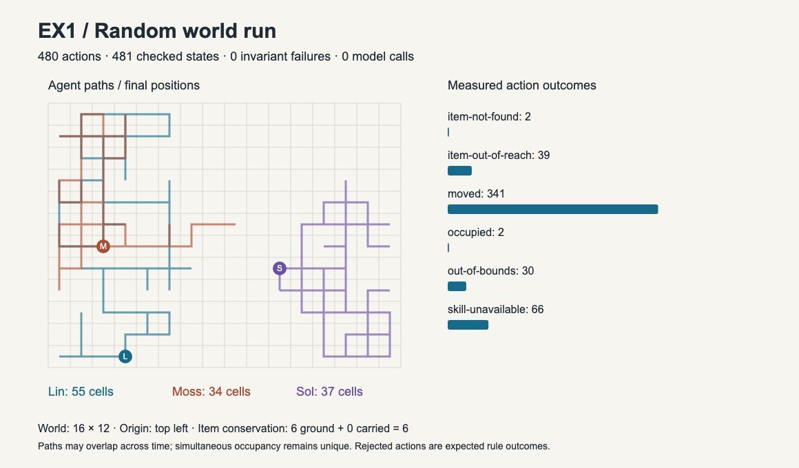
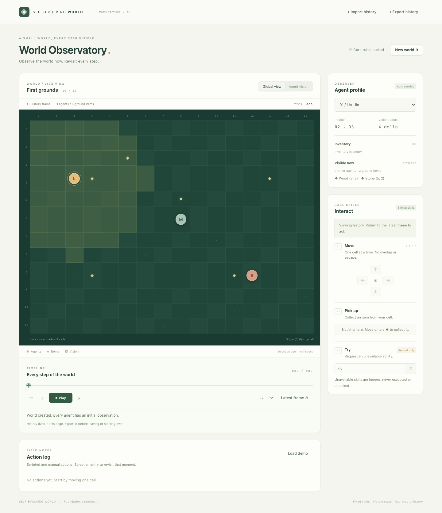
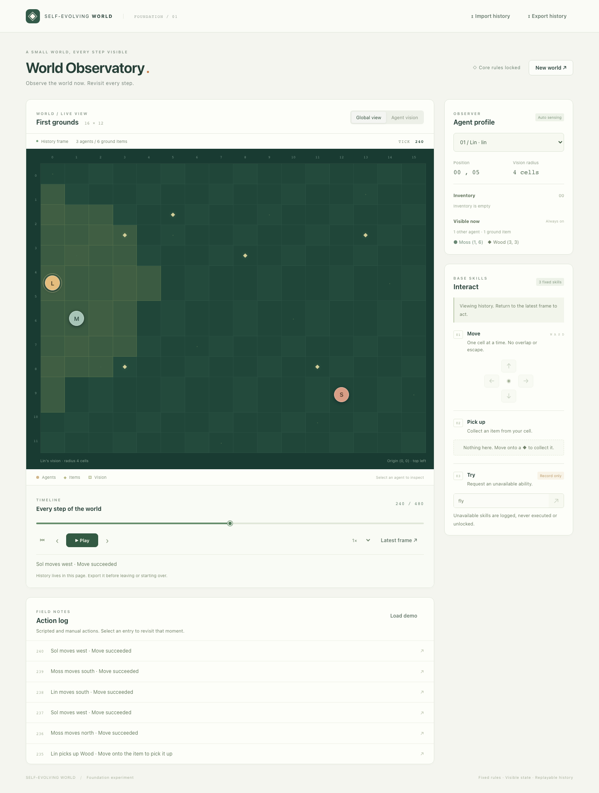
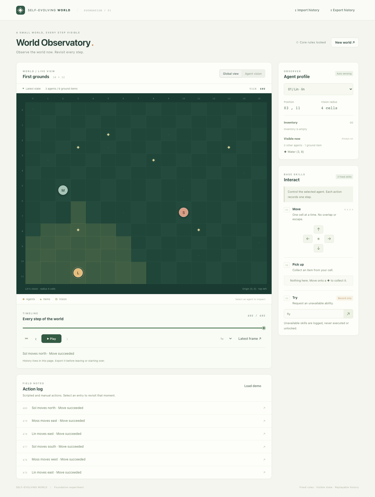

# ex1: Offline Random World Experiment

## Objective

Check whether the founding world runs normally under bounded random actions without an external agent or model, and preserve reproducible results and visual evidence.

## Method

- Foundation: version 1, 16 x 12 cells, vision radius 4, Lin/Moss/Sol and six original items.
- Seed: 20261107; generator: xorshift32; policy: xorshift32-observation-v1.
- Schedule: Lin, Moss, Sol in round-robin order for 480 total actions.
- Selection: 80% move (uniform cardinal direction), 10% pickup, 10% try.
- Pickup: choose uniformly among same-cell observed items, otherwise visible items; use unseen-item when none are visible.
- Try: choose uniformly among fly, plant and trade. Rejections are recorded without retries.
- No external agent, model, credentials or inference service is connected.

## Results

- Run status: completed.
- Actions completed: 480; snapshots checked: 481.
- Invariant failures: 0; external model calls: 0.
- State-changing actions: 341; expected rejected outcomes: 139.
- Ground items: 6; collected items: 0; conserved total: 6.

### Action counts

- move: 373.
- pickup: 41.
- try: 66.

### Outcome counts

- item-not-found: 2.
- item-out-of-reach: 39.
- moved: 341.
- occupied: 2.
- out-of-bounds: 30.
- skill-unavailable: 66.

### Agent results

- Lin: 160 turns; 55 visited cells; final position (3, 11); inventory: empty.
- Moss: 160 turns; 34 visited cells; final position (2, 6); inventory: empty.
- Sol: 160 turns; 37 visited cells; final position (10, 7); inventory: empty.

## Visual results

[Vector chart](overview.svg), [replay](replay.json), [full results](results.json), [browser checks](browser.json), [configuration and artifact hashes](manifest.json). Import replay.json into the observatory to play or seek all frames.

## Interpretation and limitations

The bounded run completed with no detected invariant failures. Boundary collisions, occupied cells, unavailable skills and rejected pickups are normal rule outcomes, not runtime crashes. Checks cover all snapshots, fixed settings and rules, occupancy, item conservation, observation privacy, and transition effects. The artifact validator also recomputes the seeded policy and compares results with replay.

This is one seeded random walk, not intelligent planning or evidence of autonomous skill evolution. Action probabilities are configured weights, not guaranteed realized proportions. Missing outcome categories were not exercised in this run; regression tests cover additional rule cases. Browser capture checks import, positions, inventories, seeking, playback, export invariance, rendering and resource health. Human or Codex visual review remains required by the task gate.
