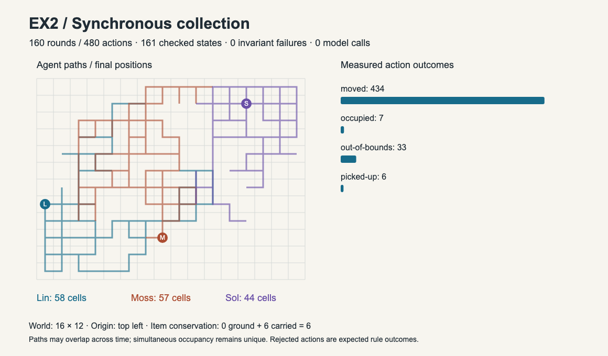
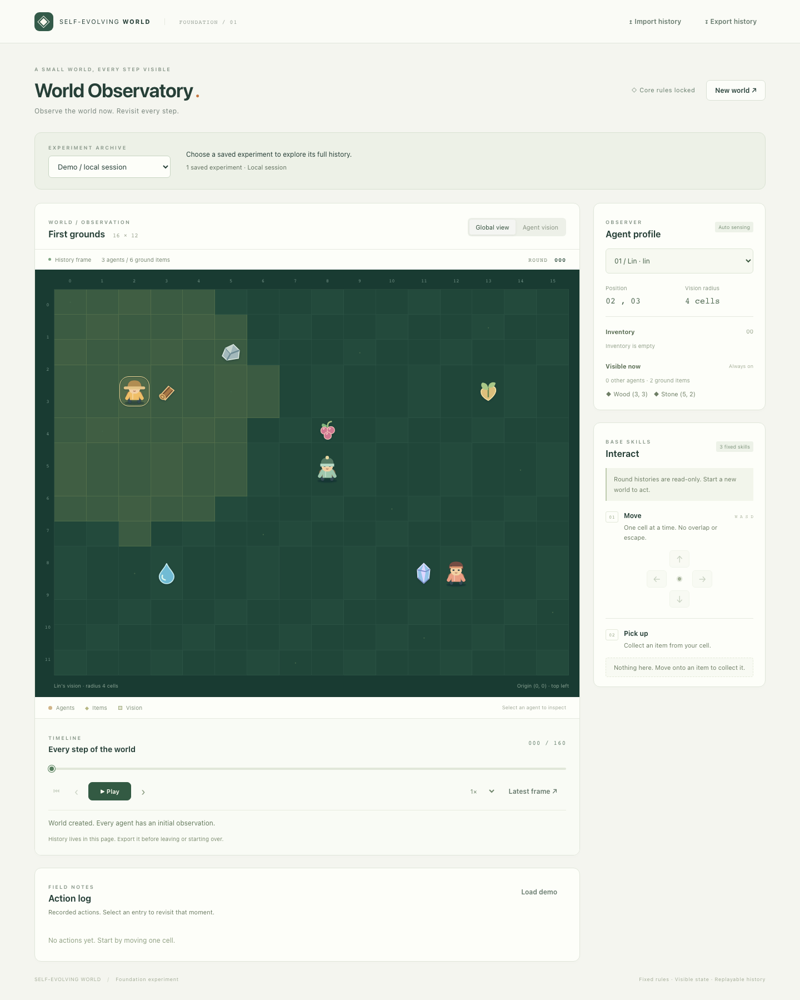
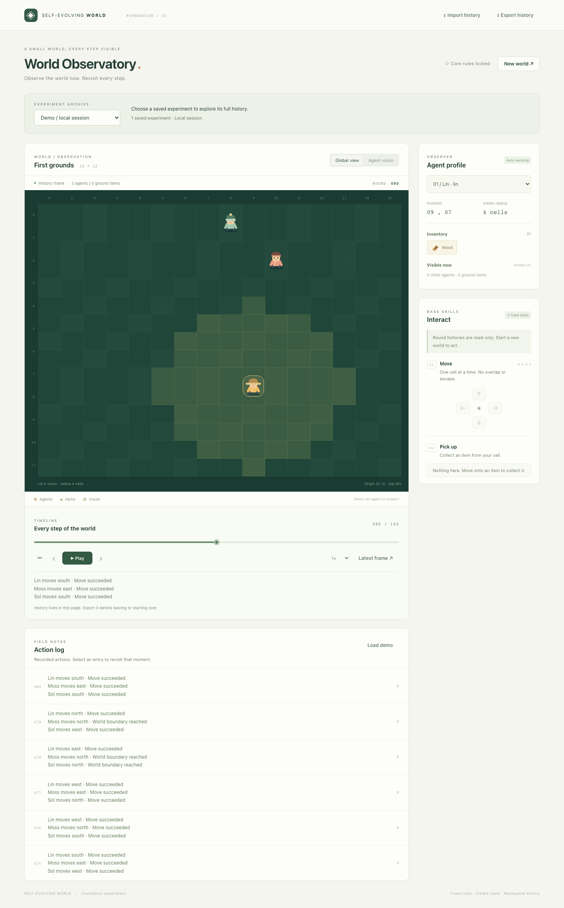
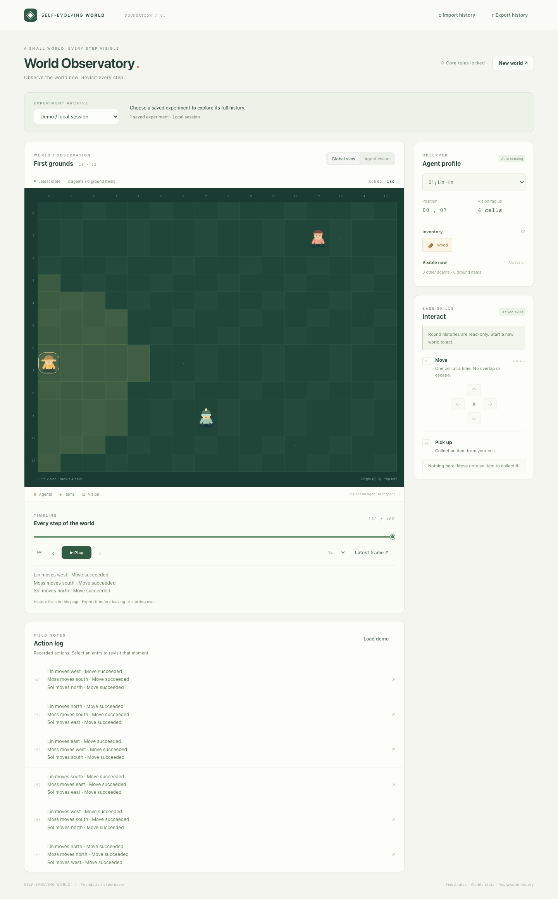

# ex2: Synchronous Collection Experiment

## Objective

Check synchronous world rounds with reproducible random exploration, successful same-cell collection, no learning attempts and no external agent or model.

## Method

- Foundation: version 1, 16 x 12 cells, vision radius 4, Lin/Moss/Sol and six original items.
- Seed: 20261107; generator: xorshift32; policy: xorshift32-collection-v2.
- Schedule: simultaneous-v1. Each agent chooses from its own round-start observation; all outcomes commit together. No intermediate agent turns appear in the replay.
- Select a same-cell item uniformly and always pick it up. Otherwise, with a visible item, use 65% attraction toward a nearest visible item (random ties and reducing directions) and 35% uniform cardinal exploration. Without visible items, explore uniformly.
- Initially occupied destinations are blocked, even if that occupant also moves. All agents competing for the same destination stay put. No swaps, priority advantage or retry.
- No try actions, learning attempts, external agents, models or inference services.
- Replay version 2 preserves rounds explicitly. The ex1 archive and version-1 sequential replay semantics remain unchanged.

## Results

- Run status: completed.
- Rounds: 160; total actions: 480; snapshots checked: 161.
- Invariant failures: 0; external model calls: 0.
- State-changing actions: 440; expected rejected outcomes: 40.
- Successful pickups: 6; learning attempts: 0.
- Ground items: 0; collected items: 6; conserved total: 6.

### Action counts

- move: 474.
- pickup: 6.
- try: 0.

### Outcome counts

- moved: 434.
- occupied: 7.
- out-of-bounds: 33.
- picked-up: 6.

### Agent results

- Lin: 160 turns; 58 visited cells; final position (0, 7); inventory: Wood.
- Moss: 160 turns; 57 visited cells; final position (7, 9); inventory: Berry, Stone, Water.
- Sol: 160 turns; 44 visited cells; final position (12, 1); inventory: Crystal, Seed.

## Visual results

[Vector chart](overview.svg), [replay](replay.json), [full results](results.json), [browser checks](browser.json), [configuration and artifact hashes](manifest.json). Import replay.json into the observatory to play or seek all frames.

## Interpretation and limitations

Every snapshot passed bounds, occupancy, immutable settings/rules, population, item conservation and private-observation checks. Independent round checks verify all actor actions, destinations, collisions and inventory transfers against the same starting snapshot. Saved artifacts must match a complete seeded reconstruction, browser checks and content hashes.

This run demonstrates simultaneous scheduling and successful collection, not intelligent planning or learning. Attraction is a fixed local heuristic; action probabilities do not guarantee realized proportions or full collection for every seed. Boundary and collision rejections are normal rule outcomes. Conservative collision handling may cause temporary congestion. ex1 used 480 sequential actions including unavailable-skill attempts; compare total actions, not its tick count, with this run. Browser evidence records the current viewer; actual visual review remains a separate required gate.
